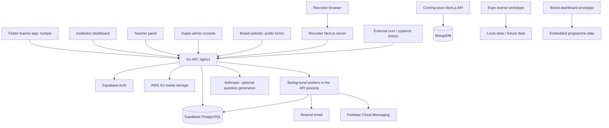

# Qwish Workspace Architecture

Last reviewed: 2026-10-06.

This document describes the implementation present in this workspace. Source code, dependency manifests, SQL migrations, and deployment configuration take precedence over older PRDs, plans, and audits. Deployment descriptions reflect checked-in configuration; they do not certify what is currently running in production.

## 1. System overview

Qwish is an education and assessment platform serving learners, teachers, institutions, platform administrators, and recruiters. Its central application is a **Go modular monolith**: one HTTP server and its background workers share a PostgreSQL database. Frontends are independently built applications, rather than one root-managed monorepo.

The main learner application is Flutter, retained under the historical directory name `numpie/` but branded Qwish in its code. The Expo learner application is currently a separate prototype. Institutional dashboards consume the shared API. The recruiter dashboard introduces a Next.js server between the browser and API. The coming-soon website has its own MongoDB-backed API and is a separate persistence boundary.



There is no checked-in Redis, Kafka, separate queue service, or independently deployed worker binary in the core runtime. PostgreSQL provides durable jobs, distributed rate limits, read models, and cross-replica notifications.

## 2. Workspace map

The root has no shared application manifest, build command, or test runner. Individual projects have their own manifests and, where present, Git repositories. Run commands inside the relevant project.

| Path | Stack / role | Integration boundary |
| --- | --- | --- |
| `qwish-backend/` | Go 1.27.1, chi v5, pgx v5; central API and workers | PostgreSQL, Supabase Auth, S3, Resend, FCM, optional Anthropic |
| `numpie/` | Flutter; Dart SDK constraint `^3.11.0` | Direct Go API client; Firebase push, analytics, and crash reporting |
| `qwish-institute-dashboard/` | Next.js 16.2.3, React 19, TypeScript | Browser API requests; Cloudflare OpenNext runtime |
| `qwish-teacher-panel/` | Next.js 16.2.3, React 19, TypeScript | Browser API requests; static export on Cloudflare |
| `qwish-super-admin/` | Next.js 16.3.3, React 19, TypeScript | Browser API requests; Cloudflare OpenNext runtime |
| `qwish-recruiter-dashboard/` | Next.js 16.2.9, React 19 | Server-side API client and cookie-backed session |
| `qwish-brand-dashboard/` | Next.js 16.2.9, React 19 | Programme/campaign UI with embedded sample data; no backend client found in its source |
| `qwish-brand-website/` | Next.js 16.2.4, React 19, Framer Motion | Static marketing site; public contact and institution-application requests to Go API |
| `qwish-web-coming-soon/` | Next.js 16.1.6, Mongoose 9 | Own `/api/waitlist` and `/api/contact` routes backed by MongoDB |
| `qwish-web-app/` | Expo 57, React Native 0.86.3, React Native Web | Learner prototype; active shell uses fixtures and local state |
| `packages/qwish-ui/` | React component and theme package, `@qwish/ui` | Source-level UI reuse, not a backend/API package |
| `avatar-gen/` | Standalone Go module, Go 1.26.1 | Avatar generation utility; the backend also contains an avatar implementation |

Supporting material includes `qwish-assets/`, `qwish-designs/`, sample quizzes, `plans/`, code reviews, audit reports, `graphify-out/`, and generated launch-video projects in `brag-output*`. `web-desgn-2/` is auxiliary design material. `qwish-hr-leetcode-monitor-extension/` currently contains a code-review document but no extension implementation in the visible file inventory. These directories are not wired into `cmd/api/main.go`.

## 3. Backend organization and lifecycle

The composition root is [qwish-backend/cmd/api/main.go](../../cmd/api/main.go). It explicitly constructs dependencies and registers HTTP routes; there is no dependency-injection framework.

```text
qwish-backend/
  cmd/api/                 Server startup, dependency wiring, routes, health
  internal/config/         Environment configuration and startup validation
  internal/db/             pgx pools, migrations, membership SQL, LISTEN
  internal/domain/          Business domains and HTTP handlers
  internal/middleware/      Authentication, authorization, limits, cache, logs
  internal/jobs/            PostgreSQL-backed job queue and workers
  internal/scheduler/       Maintenance and scheduled-delivery operations
  internal/cache/           Bounded process-local cache
  internal/storage/         AWS S3 client and signed URLs
  internal/playintegrity/   Android integrity verification
  internal/algorithms/      Probabilistic/search helpers
  internal/httpx/           Shared outbound HTTP support
  internal/jsonx/           JSON decoding support
  internal/supabase/        Supabase invitation support
  migrations/              Ordered SQL schema and data changes
  deploy/                  Compose, Caddy, release script, systemd cron
  bruno/                   API request collection
```

The typical request path is `router → middleware → handler → service → SQL`, but the layering is not uniform. Many administration, institution, teacher, metrics, and reporting handlers execute SQL directly through a shared `pgxpool.Pool`. There is no universal repository interface or ORM.

Startup proceeds as follows:

1. Create a signal-cancelled context and load configuration, including an optional local `.env`.
2. Connect the request database pool and apply unapplied migrations.
3. Exit early for `MIGRATE_ONLY=true`, or execute and exit for `BACKFILL_RATINGS=true`.
4. Initialize S3, domain services, handlers, notification delivery, and optional integrity support.
5. Connect a separate worker database pool; register durable job handlers.
6. Start cache invalidation and notification listeners, plus three queue workers.
7. Start the chi HTTP server, normally on port 8080.

On SIGINT/SIGTERM, readiness becomes unavailable, the server drains for up to 25 seconds, remaining connections are closed if necessary, and worker shutdown is awaited.

### Domain responsibilities

| Domain packages | Responsibility |
| --- | --- |
| `auth`, `useremail` | OTP/session flows, profiles, passkeys, sign-ins, verified secondary emails |
| `user` | Learner profile, preferences, insights, recommendations, content, achievements, profile entries, reports |
| `quiz`, `attempt`, `scoring` | Quiz catalogue/authoring, delivery, answer processing, evidence, XP and ability rating |
| `points`, `streak`, `leaderboard` | Point ledger and balances, streak state/bonuses, rankings and snapshots |
| `onboarding`, `onboardingsession`, `demo`, `featureonboarding` | Institution applications, guest calibration and claiming, demo quizzes, teacher feature onboarding |
| `enrollment`, `institution`, `teacher` | Institution relationships, class membership/history, staff, classrooms and scoped workspaces |
| `curriculum`, `learning` | Versioned curricula, concepts, question mappings, assignments, misconceptions and follow-up evidence |
| `leadership` | Institution/department leadership assignments and scoped summary access |
| `activity`, `notice`, `survey` | Forms, events/polls, targeted notices, and anonymous surveys |
| `portfolio` | Student portfolio visibility, evidence submissions, revisions and teacher reviews |
| `admin`, `analytics`, `metrics` | Moderation, account/platform management, operational reports, configurable dashboards and scoped metrics |
| `recruiter` | Organisation membership, visible candidates, candidate state and recruitment audit |
| `notification`, `push` | Persisted notifications, SSE, durable email and FCM delivery |
| `parent`, `studygroup`, `topicrequest` | Family links, learner social/study groups, requested learning topics |
| `upload`, `avatar`, `contact` | Media upload, generated avatars, public enquiries |

These are code boundaries inside one application. They share tables and call each other; they are not isolated microservices.

## 4. HTTP contracts and access boundaries

The main API prefix is `/api/v1`. [main.go](../../cmd/api/main.go) is the authoritative route registry; [API_DOC.md](../../API_DOC.md) and the Bruno collection provide additional endpoint documentation.

| Surface | Examples / purpose |
| --- | --- |
| Public | `/auth/*` login flows, `/contact`, `/onboarding/*`, `/demo/*`, `/avatars/*`, public surveys |
| Learner | `/users/me/*`, `/quizzes/*`, `/attempts/*`, `/offline/*`, enrollment and class joining |
| Teacher | `/teacher/*`: assessments, classes, assignments, evidence, support, activities, reports |
| Institution | `/institution/*`: institution administration, staff, learners, curriculum, reporting |
| Leadership | Scoped leadership reads and activity publishing; routes also registered by domain helpers |
| Recruitment | `/recruiter/*`: context, overview, candidates and shortlist state |
| Platform administration | `/admin/*`: moderation, institutions, users, point rules, announcements, security policy |
| Internal operations | `/internal/cron/*` and `/internal/profile/*`, protected by `X-Cron-Secret` |

Most JSON responses use the envelope from [respond.go](../../internal/middleware/respond.go):

```json
{"success": true, "data": {}, "error": null}
```

Paginated responses add `meta` with page, limit, total, and optionally `next_cursor`. Errors carry `success: false` and an `error` object containing `code` and `message`. Binary/report responses and SSE have separate response formats. Frontend adapters differ in how they unwrap envelopes and preserve pagination metadata.

Middleware supplies request IDs, request observation/logging, panic recovery, body limits, security headers, configured CORS, authentication, route-specific rate limits, and selected GET response caching. The global body ceiling is 3 MiB for ordinary requests and 26 MiB for multipart requests; handlers may impose smaller limits.

Ordinary routes have a 30-second timeout. The notification stream bypasses that group. Internal cron endpoints have a 15-minute budget. AI generation has a separate roughly 95-second request budget and can use durable generation jobs.

### Identity and authorization

Supabase Auth supplies the authentication identity and session flows. JWT verification supports the configured symmetric secret and Supabase JWKS; backend passkey flows also mint tokens. Authorization is derived from live application records, rather than accepting role claims as sufficient authority.

- `users` represents application identities; `admin_accounts` represents console identities. Middleware supports both and keeps their IDs distinct when an account has both records.
- Authentication checks deletion/status, institution state, token-generation revocation, and administrator session/passkey policy. `RequireUserRecord` protects operations whose foreign keys require a real `users` row.
- Route role gates are supplemented by domain checks for institution, class, ownership, recruiter membership, and evidence visibility. UI guards are navigation aids; the API owns permission enforcement.
- Leadership permissions require one active assignment that contains both the permission and a covering institution/department scope. A title alone does not grant access to individual activity responses or learning evidence.
- The Flutter client sends `X-Qwish-Client: numpie`; middleware restricts that surface to student/parent access.
- Public forms can require Cloudflare Turnstile. Android attempt completion supports Play Integrity modes `off`, `observe`, and `enforce`.

See [auth.go](../../internal/middleware/auth.go), [jwks.go](../../internal/middleware/jwks.go), [admin_session.go](../../internal/middleware/admin_session.go), and [leadership/roles.go](../../internal/domain/leadership/roles.go).

## 5. Persistence and ownership

The core relational database is PostgreSQL with Supabase-specific auth/role integration. Domains use handwritten parameterized SQL, transactions, row/advisory locks, foreign keys, constraints, indexes, and database triggers. Migrations also define RLS and database grants; backend authorization remains an explicit application responsibility.

| Data area | Representative tables |
| --- | --- |
| Identity and security | `users`, `admin_accounts`, `admin_sessions`, `user_emails`, `webauthn_credentials`, `webauthn_user_credentials`, `platform_settings` |
| Institution membership | `institutions`, `enrollments`, `institution_domains`, `student_invites`, `groups`, `group_students`, `group_teachers`, `group_student_history` |
| Leadership | `departments`, `staff_role_assignments` |
| Assessments | `quizzes`, `questions`, `question_versions`, `question_options`, `quiz_attempts`, `quiz_attempt_questions`, `question_responses`, `clue_reveals`, `attempt_behavior_events` |
| Scoring and adaptation | `points_ledger`, `learner_ratings`, `learner_topic_mastery`, `recommendation_bandit_stats`, `leaderboard_scores` |
| Learning | `curricula`, `curriculum_versions`, `curriculum_chapters`, `curriculum_concepts`, `class_curricula`, `learning_assignments`, `learning_assignment_recipients`, `learning_evidence`, `misconception_reviews` |
| Portfolio and activities | `user_profile_entries`, entry revisions/reviews, `activities`, `activity_versions`, `activity_responses`, response history and audit events |
| Communication | `user_notifications`, `device_tokens`, `notification_log`, `notices`, `notice_audience`, content-delivery and announcement records |
| Recruitment | `recruiter_organisations`, `recruiter_memberships`, `recruiter_roles`, `recruiter_candidate_states`, `recruiter_audit_events` |
| Reliability/read models | `background_jobs`, `distributed_rate_limits`, `quiz_read_stats`, `attempt_daily_metrics`, `offline_answer_exposures`, `schema_migrations` |

This is a navigation map, not an exhaustive schema listing. Full table definitions and their subsequent alterations live in [migrations/](../../migrations/).

### Membership model

A learner owns their account independently of any institution. `enrollments` records institution membership; `users.institution_id` selects the currently active institute rather than representing every membership. A learner can have up to **two live institutes**, enforced by transactional joining logic. A learner without an institute is a valid state.

Classes are represented by `groups` and joined through `group_students`; teacher assignments use `group_teachers`. Class membership and institution enrollment are related but distinct. Class ending/history is preserved rather than handled through the former promotion-batch workflow. Learner social groups use the separate `study_groups` tables.

Recent migrations changed this model materially:

- `084_identity_and_joining.sql` introduced secondary emails, verified institution domains, and student invites.
- `085_erp_retreat.sql` removed unclaimed roster rows, student-edit requests, roll/admission fields, and several personal/guardian fields. Invites are not pre-created learner accounts.
- `086_classes_and_history.sql` introduced class membership history and removed promotion-batch tables.
- `087_notices_and_remedial.sql` added notices and remedial-class support.

Historical admission/roster PRDs and old handler comments therefore do not describe all current behavior.

### Migration and connection model

The migration runner sorts SQL filenames, records full filename stems in `schema_migrations`, and applies each pending file transactionally. An advisory lock serializes migration inspection/application across replicas. There are 93 checked-in migration files, numbered through `094_security_hardening.sql`; the sequence has no `030` file. Filename gaps are supported. There is no down-migration runner or content-checksum verification.

The request pool defaults to minimum 2 / maximum 10 connections. The worker pool defaults to minimum 1 / maximum 8 and requires a maximum of at least 6 for workers and listeners. `WORKER_DATABASE_URL` can override the worker connection URL. PostgreSQL `LISTEN` requires a direct or session-pooled connection; a transaction pooler is unsuitable for the worker listeners.

## 6. Critical application flows

### Quiz attempt and completion

```mermaid
sequenceDiagram
    participant C as Learner client
    participant A as Attempt API
    participant D as PostgreSQL
    participant W as Job workers
    C->>A: Start quiz with optional assignment context
    A->>D: Validate access; persist attempt and delivery snapshots
    A-->>C: Attempt, ordered questions, answer state
    C->>A: Submit answer / reveal clue / record behavior
    A->>D: Validate attempt and persist server-derived result
    C->>A: Complete attempt
    A->>D: Transaction: lock attempt and learner, score, ledger, rating, streak, badges, assignment status, notifications, jobs
    D-->>A: Commit stored completion response
    A-->>C: Result, XP delta, Qwish Score and delta
    W->>D: Claim jobs and update derived learning/read models
    W->>W: Deliver queued push/email
```

An attempt stores delivery context, question/version references, option ordering, and point-configuration snapshots. Later question edits should not reinterpret historical answers. Answer processing applies server gates for correctness, timing, clues, and combos; client-reported results are not the scoring authority.

Completion locks the attempt and learner, calculates rewards and ability changes, records assignment submission, streak/badge changes, and persists the completion response in one transaction. Repeating completion returns the stored response. Deferred learning work is enqueued with the committed event, so it survives an API restart. Read-stat refreshes are also queued by database triggers.

**XP and Qwish Score are separate concepts.** XP uses the configurable point economy, including question types, confidence, clues, time, repeat rules, and relevant multipliers/bonuses. Qwish Score is an ability estimate from [scoring/rating.go](../../internal/domain/scoring/rating.go): a Rasch-style logistic model with uncertainty updates, published as `theta - 2 * sigma`, clamped to 100–900. Eligible first-time question evidence updates it; speed, streaks, and activity feed XP rather than ability. Older five-factor score helpers and UI terminology still exist and should not be confused with the current rating implementation.

Downloading an offline answer key records exposure. Such quizzes become practice for authoritative reward/rating handling. Offline results synchronize to practice records rather than being trusted as ordinary scored attempts.

### Join an institution/class

1. The learner previews a class code and sees the exact institution/class destination.
2. Admission eligibility comes from a pending invite matched to a verified email, a verified institution email domain, or a class that permits code joining.
3. Confirmation locks the learner and validates that the class/code destination is unchanged.
4. The transaction enforces role, suspension, and institute-cap rules, ensures enrollment, inserts class membership, consumes matching invites, and selects the active institute.
5. Leaving, enrollment status changes, and class ending preserve the account and relevant history.

See [enrollment/join.go](../../internal/domain/enrollment/join.go), [membership.go](../../internal/domain/enrollment/membership.go), and [pastclasses.go](../../internal/domain/enrollment/pastclasses.go).

### Teaching and learning evidence

Teachers author assessments and map questions/options to curriculum concepts and misconceptions. Assignments carry recipient and delivery context; attempts connect back to those recipients. Completion and deferred processing produce learning evidence and topic mastery. Teacher support reviews, remedial classes, and follow-up assignments support intervention tracking. Institution and leadership views use scoped summaries, while individual evidence access is checked separately.

Activities are a separate versioned form/event/poll subsystem with audience groups, responses, history, and audit records. Anonymous surveys are another subsystem with public slug/receipt flows. Neither should be treated as an ordinary quiz attempt.

### Notifications and content delivery

In-app notifications are persisted first. `EmitTx` can write both a notification and its push job in the caller's transaction. Email delivery supports durable queueing and transactional enqueueing as well as explicit direct delivery, such as login OTPs. FCM sends to registered device tokens; Resend sends email. Announcements use scheduled dispatch and persisted delivery state.

Notification inserts trigger PostgreSQL broadcasts. Each API replica listens and publishes to its local SSE subscribers. The `/users/me/notifications/stream` endpoint supports the browser EventSource token transport exception and reconnect handling; persisted notification reads remain available independently of the live stream.

## 7. Jobs, caches, and derived data

The queue in [internal/jobs/jobs.go](../../internal/jobs/jobs.go) stores payloads, results, attempt counts, errors, availability times, and lease tokens in `background_jobs`.

- Workers claim eligible jobs with `FOR UPDATE SKIP LOCKED`.
- A job lease lasts three minutes; execution gets a two-minute context.
- Expired leases can be reclaimed. Failures retry with capped exponential delay until the attempt limit, then remain in a failed state.
- Transactional job handlers can commit effects and completion together. External delivery handlers cannot share one transaction with remote providers, so durability does not imply universal exactly-once delivery.
- Registered work includes learning evidence, question calibration, quiz statistics, email, push, announcement notifications, and teacher question generation. Rating backfill is a separate startup mode.

Response and domain caches are process-local, bounded, and use TTLs. Writes and database broadcasts invalidate selected cached data. PostgreSQL notifications on `qwish_cache` clear or selectively invalidate response caches, leaderboard data, scoring config, and recommendations across API replicas. Listener reconnects clear caches to cover missed broadcasts.

Derived data uses several consistency strategies: quiz statistics refresh asynchronously through `quiz_read_stats`; daily attempt metrics and incremental leaderboard state use database-maintained structures. A freshly committed attempt can precede refreshed catalogue statistics or deferred learning summaries.

Maintenance scheduling is external. [deploy/cron/run-cron.sh](../../deploy/cron/run-cron.sh) groups hourly, nightly, announcement, streak-nudge, leaderboard-snapshot, and digest requests. Tasks close expired quizzes, abandon stale attempts, remind assignment recipients, expire points, reset streaks, recompute difficulty, clean transient data, end inactive enrollments, and deliver scheduled communications. Alternate Render and opt-in GitHub Actions scheduling is retained; one scheduler should own each production schedule.

## 8. Frontend architectures

### Flutter learner application

[numpie/lib/main.dart](https://github.com/qwish/qwish-app/blob/main/lib/main.dart) initializes Firebase with a bounded timeout, applies telemetry consent, launches the app, then initializes push off the critical path. App startup constructs dependencies, restores the session, creates the router, and connects auth transitions to enrollment/content loading, push registration, and system gates.

Features are organized as `lib/features/<feature>/{data,bloc,presentation}` where applicable. Features cover auth, onboarding/calibration/demo, browse/attempts, home, assignments, curriculum, enrollment, activities/notices/surveys, insights, leaderboard, notifications, profile, settings, student data, and shell navigation.

- GetIt registers shared infrastructure/repositories and BLoC/Cubit state objects in [service_locator.dart](https://github.com/qwish/qwish-app/blob/main/lib/core/di/service_locator.dart).
- Dio centralizes bearer authentication, single-flight refresh/retry, typed errors, and account/system status signals in [api_client.dart](https://github.com/qwish/qwish-app/blob/main/lib/core/network/api_client.dart).
- Secure storage holds tokens and sensitive cached identity data; shared preferences hold settings. `AppCache` provides client caching.
- GoRouter supplies app routing, deep links, and auth-aware navigation. Push references can open app destinations.
- Firebase supplies FCM, Analytics, and Crashlytics. Localization and adaptive layout live under `lib/core/` and `lib/l10n/`.
- The API URL is currently hardcoded in `lib/core/constants.dart`; its old “NestJS API” comment is stale. The implementation served by this workspace is Go.

Android/iOS and desktop/web platform scaffolding exists. Source presence does not establish equal feature support or deployment readiness on every platform.

### Institution, teacher, and super-admin applications

All three use Next.js App Router, TypeScript, React, Tailwind CSS, feature components, API adapters, and custom hooks. Institution/teacher API modules are split under `src/lib/api/`, with shared fetch logic in `src/lib/apiClient.ts`. Super-admin uses the broader `src/lib/api.ts` adapter.

These clients store access/refresh tokens in browser local storage and call the Go API directly. Refresh handling and envelope adaptation are implemented separately in each client. Authentication guards and permission-aware menus control presentation; backend checks enforce access. Metrics hooks and configurable widget canvases support saved dashboard layouts; charting uses Recharts.

The teacher app statically exports its client-driven routes. Institution and super-admin use the OpenNext Cloudflare adapter. Those runtime differences matter when adding server-only code: teacher functionality cannot assume a deployed Next.js server.

### Recruiter dashboard

The recruiter app uses a server-only API adapter in [recruiter-api.ts](qwish-recruiter-dashboard/src/lib/recruiter-api.ts). Server components fetch recruiter context, overview, and candidates with `cache: no-store`. Auth route handlers establish HTTP-only cookies; `src/proxy.ts` gates navigation and supports refresh. A same-origin route forwards shortlist mutations to the Go API. Organisation membership and candidate visibility are enforced by the backend recruiter domain.

### Public sites and prototypes

The brand website statically exports marketing content and sends public forms directly to the Go `/contact` and `/onboarding/institution` endpoints. It also contains PostHog event delivery. Its deployment checks require configured public integration settings.

The coming-soon site owns Next.js route handlers, Mongoose connection caching, and `Waitlist`/`Contact` models. Its MongoDB records are not automatically synchronized with Go `contact_submissions` or institution applications.

The Expo entry point mounts `NavProvider → Shell → pages`. The active pages use `src/ui/data.ts`, navigation state, and local persistence. An older `ApiService` and context/screen tree remains, with limited profile/insight requests and mock fallbacks; its presence does not make the active application a fully connected learner client. Passkeys/profile mutations in the active pages are explicitly mocked.

The brand dashboard displays sample programme data and interactive local UI. Backend brand and promo administration exists, but there is no corresponding live brand-dashboard API integration in the inspected source.

### Shared UI

`packages/qwish-ui` exports React components and theme tokens as source. The brand dashboard references this root package. Institution and teacher also contain vendored `packages/qwish-ui` copies for independent builds. This is reuse by source/package linkage, not a centralized versioned release pipeline; copies can drift.

## 9. Deployment, configuration, and operations

### Backend deployment

The current AWS deployment path is described in [AWS_LIGHTSAIL_DEPLOYMENT.md](../../docs/AWS_LIGHTSAIL_DEPLOYMENT.md):

```text
HTTPS client → Caddy on Lightsail → API container :8080
                                      ├─ Supabase PostgreSQL/Auth
                                      ├─ AWS S3
                                      └─ outbound provider APIs
Host systemd timers → loopback :8080/api/v1/internal/cron/*
```

The Dockerfile builds a static Go binary and includes migrations in a non-root Alpine image. GitHub Actions builds tagged multi-architecture images for GHCR. Compose runs the API with a read-only filesystem, temporary `/tmp`, dropped capabilities, resource limits, readiness health checks, and bounded container logging.

Caddy terminates TLS and blocks public `/api/v1/internal/*` requests; host timers access loopback directly. `deploy/deploy.sh` supplies the release workflow. `render.yaml` and GitHub cron are alternate/transition artifacts, not proof that Render remains the sole deployment target.

### Configuration boundaries

| Concern | Configuration |
| --- | --- |
| Core database/auth | `DATABASE_URL`, `SUPABASE_URL`, `SUPABASE_ANON_KEY`, `SUPABASE_SERVICE_ROLE_KEY`, `SUPABASE_JWT_SECRET` |
| Object storage | Required `AWS_REGION`, `S3_BUCKET_NAME`; optional `S3_PUBLIC_URL`; AWS SDK credential chain |
| Serving/security | `PORT`, `APP_ENV`, `ALLOWED_ORIGINS`, `CRON_SECRET`, WebAuthn RP settings, optional `TURNSTILE_SECRET` |
| Database budgets | `DB_MIN_CONNS`, `DB_MAX_CONNS`, `WORKER_DATABASE_URL`, `WORKER_DB_MAX_CONNS`, optional `MIGRATIONS_DIR` |
| Communication | `RESEND_API_KEY`, `FCM_PROJECT_ID`, `FCM_SERVICE_ACCOUNT_JSON`, app/dashboard/brand URLs |
| Optional features | `ANTHROPIC_API_KEY`, `ANTHROPIC_MODEL`, Play Integrity settings, configured store-review/demo login |
| Browser dashboards/marketing | `NEXT_PUBLIC_API_URL`, including the API prefix; baked into client builds |
| Recruiter server | `QWISH_API_URL`; defaults to local `http://localhost:8080/api/v1` |
| Coming-soon server | `MONGODB_URI` |

Production startup requires a non-wildcard origin configuration, a cron secret, and FCM project/credential settings. S3 initializes credentials at startup. R2 variables described by older documentation are not the current storage contract. Secret values and service-account files are intentionally omitted from this document.

### Health and observability

`/health` is a liveness response. `/ready` checks database availability and shutdown state. Request logs/IDs and operational counters support API troubleshooting. Secret-protected internal profiling includes quiz-query profiling, goroutine-leak information, and operational metrics. Job rows and notification logs provide durable failure/delivery information. Firebase covers learner telemetry/crashes; the public marketing site includes PostHog. There is no single workspace-wide observability runtime.

## 10. Development, verification, and extension points

Use each project's installed toolchain and lockfile. Common commands are:

| Project | Commands from that directory |
| --- | --- |
| Go API | `go build ./cmd/api`, `go test ./...`, `docker build -t qwish-backend .` |
| Flutter | `flutter pub get`, `flutter analyze`, `flutter test`, `flutter run` |
| Next.js apps | `npm run dev`, `npm run build`, `npm run lint`, or the equivalent Bun commands |
| Institution/teacher focused tests | `bun test src/lib` where Bun is available; library tests use `bun:test` or `node:test` |
| Expo prototype | `npm run web`, `npm run android`, `npm run ios` |
| Shared UI | `npm run typecheck` from `packages/qwish-ui` after dependency installation |
| Avatar utility | `go test ./...` from `avatar-gen` |

Backend tests include pure scoring/algorithm tests, HTTP/middleware tests, migration/SQL checks, and database integration tests. Many integration suites skip unless `TEST_DATABASE_URL` points to a suitable scratch PostgreSQL database. Ordinary test success without that setting does not establish database behavior. Flutter includes repository, model, state, routing, and widget tests. Institution/teacher contain focused library tests, despite older root guidance saying the Next.js apps have no tests. No root test pipeline exists, and the container-build workflow does not itself run the complete test suite.

When extending the system:

1. Register dependencies/routes in `cmd/api/main.go`, preserving authentication and resource-scope checks.
2. Add the next ordered migration for schema changes; preserve shipped migration history and account for existing data.
3. Keep authoritative attempt effects and required outbox jobs in one transaction. Put slow/retryable derived work in the durable queue.
4. Specify cache/read-model invalidation and whether a new response is immediately or eventually consistent.
5. Update the API contract and every consuming client's adapter/types. There is no single generated cross-language schema covering Go, Dart, and TypeScript.
6. Respect each frontend's runtime: static export, OpenNext Worker, and server-backed Next.js have different capabilities.
7. Validate the changed project and run database tests against a scratch database when changing SQL or transactional invariants.

## 11. Current architectural constraints

- API replicas can share PostgreSQL jobs, limits, and broadcasts, but each replica also runs workers/listeners. Increasing replica count increases connection and provider traffic; budget both pools together.
- PostgreSQL is a shared dependency for requests, auth checks, queue progress, limits, and read-model maintenance. Separate pools isolate connection contention, not database outages.
- Cache broadcasts are transient; TTLs and reconnect clearing complement them. Derived views can lag committed source records.
- Domains are coupled through shared SQL/schema and explicit service calls. Extracting a domain would require identifying its transactions and data ownership first.
- Frontend session and API logic is duplicated, including differing refresh/error/pagination behavior. The recruiter cookie/server model is distinct from dashboard local-storage sessions.
- Mock application surfaces and leftover implementation trees coexist with connected clients. Route/entry-point tracing is necessary before changing apparently shared code.
- Existing plans and audits span several architecture revisions. In particular, old R2/Render assumptions, roster/admissions workflows, promotion batches, five-factor scoring, and the stale NestJS comment should not override the current source.

This file should be updated when deployment topology, ownership, authentication, scoring, schema/read-model behavior, or frontend integration boundaries change.
