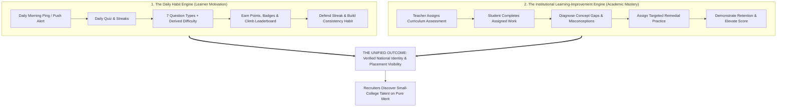
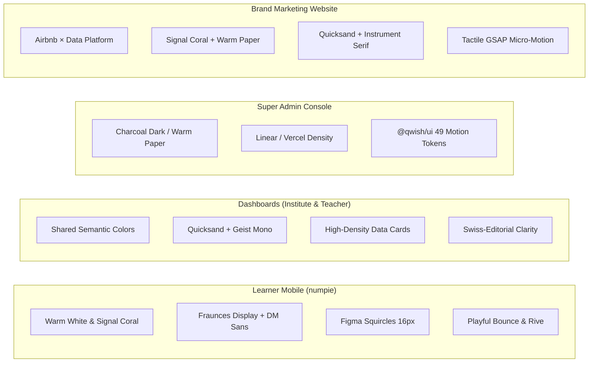

# Product

<!-- impeccable:product-schema 1 -->

**Last implementation review: 21 October 2026.** This document describes repository implementation, not a verified production rollout. The current-change inventory below covers the Qwish learner app, teacher panel, institute dashboard, and their shared backend. Other platform surfaces retain their earlier overview; historical audit results are dated evidence, not current certification.

## Platform

adaptive

Qwish is one unified product across two primary design languages: a native mobile experience for learners (iOS and Android via Flutter) and desktop-first web surfaces for management, authoring, institutional operations, and talent recruiting. Mobile web counts as web, not native.

Surfaces & Workspaces:

| Surface | Repo / Directory | Platform | Role & Stack |
|---|---|---|---|
| Learner mobile app | `numpie/` | iOS + Android (Flutter) | Primary learner experience: daily quiz player, streak habit engine, points ledger, leaderboards, assigned work hub, curriculum browser |
| Learner web companion | `qwish-web-app/` | Web / mobile web (React Native Web / Expo) | Responsive web companion for students on desktop and mobile web: shell, browse, quiz player, profile |
| Central Backend API | `qwish-backend/` | Go 1.27.2 + Chi — serves every surface | Monolithic REST API binary with pgxpool, transactional migrations, scheduled tasks and configurable background job workers |
| Teacher panel | `qwish-teacher-panel/` | Web, desktop-first | Next.js 16: quiz authoring, per-question curriculum mapping, assignment dispatcher, student support notes, remedial reviews |
| Institute dashboard | `qwish-institute-dashboard/` | Web, desktop-first, responsive to tablet | Next.js 16: academic years, multi-version immutable curriculum trees, class-code membership, college structure, leadership access and learning-support oversight |
| Recruiter dashboard | `qwish-recruiter-dashboard/` | Web, desktop-first | Next.js 16: sub-millisecond candidate talent search (Trigram/Bloom), verified skill profiles, hiring pipelines, custom assessment campaigns |
| Brand dashboard | `qwish-brand-dashboard/` | Web, desktop-first | Next.js 16: branded skill championships, hackathons, scholarships, live ops telemetry, merit judging, privacy-safe aggregate analytics |
| Super admin console | `qwish-super-admin/` | Web, internal (OpenNext / Cloudflare) | Next.js 16: platform telemetry, institution verification pipelines, quiz moderation queues, point economy liabilities, global audit logs |
| Brand website | `qwish-brand-website/` | Web | Next.js + GSAP: high-converting behavioral narrative marketing site, institutional onboarding forms, Cloudflare Turnstile protection |
| Coming-soon / waitlist | `qwish-web-coming-soon/` | Web | Next.js + MongoDB: pre-launch waitlist registration portal for students and college ambassadors |
| Shared UI component library | `packages/qwish-ui/` | npm workspace package (`@qwish/ui`) | 49 micro-interactive motion components (Motion, Lucide, Tailwind v4 tokens) used across modern web dashboards |
| Deterministic avatar service | `avatar-gen/` | Go microservice (internal) | Zero-dependency Bauhaus-style deterministic vector SVG avatar generator deriving unique student identities from user ID seeds |
| Candidate interview monitor | `qwish-hr-leetcode-monitor-extension/` | Chrome MV3 (planned / spec) | Proctoring browser extension tracking focus loss, clipboard pastes, window blurs, and keystroke dynamics during coding assessments |

---

## Implemented Changes — Learner, Teacher and Institute (21 October 2026)

This inventory records implemented workflows found in the current source. Roadmap documents, older surface-specific product files and historical build counts can describe superseded behavior; they are not proof that a feature is live in production.

### Qwish learner app

- **First-run discovery:** The topic/sub-topic sampler asks preference questions with no correct answers, identifies interest tracks and recommends quizzes. Signup claims the discovery session and preserves inferred interests; it does not turn preference answers into a rated assessment. The public demo quiz remains a separate entry point.
- **Passwordless identity:** Email OTP and passkeys support sign-in. Profile creation includes a neutral date-of-birth screen. Backend minor protections and parental-consent flows are implemented; consent is distinct from an ordinary parent progress-sharing link. Do not describe these changes as a legal compliance certification.
- **Membership:** Join through a class code, accept eligible invitations, hold up to two active institutes, switch the active institute and leave an institute. Secondary verified emails support institute-domain invitations. The old institution-referral/roster-claim student flow is retired.
- **Class history:** Ended-class prompts and Past Classes preserve access to historical context. A class ending is distinct from deleting the learner account or moving the learner automatically into the next grade.
- **Home and communication:** Forms & Polls and Notices have persistent Home entry points, including empty states. A dedicated notice list and notification rendering expose teacher/institution messages alongside assigned work.
- **Forms and polls:** Learners open eligible activities, see whether they are scheduled/open/closed, save or submit supported answers and view results when allowed. These activities identify the respondent: name/class disclosure appears before submission. They are separate from anonymous survey links.
- **Profiles and portfolios:** Learners edit their full name and profile, manage verified secondary emails, maintain CV/portfolio entries and control which supported sections appear publicly. Public profiles show score, percentile, accuracy, strengths and activity in the app's language. Submitted portfolio revisions can be reviewed by authorized staff; learner claims and reviewed evidence remain distinct.
- **Personal-data simplification:** The old personal-details tab and institution-managed roll number, roster status and correction-request workflows have been removed. Date of birth for age screening is a separate, deliberately retained field.
- **Avatars:** The profile wardrobe supports seeded characters and mastery-driven topic personas with growing outfit tiers. Avatar presentation is no longer described solely by the standalone Bauhaus generator.
- **Score and results:** Difficulty-aware rating, evidence discounts, idle/active status and first-time-answer rules replace the old five-factor score formula. Attempt results distinguish quiz performance, rating and rewards; unanswered questions count against performance.
- **Learner web companion:** The Expo implementation has responsive phone/tablet layouts, tablet two-column Home, updated Home/quiz-detail/settings screens and rank/score display fixes. Transient API failures no longer automatically trigger the maintenance gate. Mobile features listed above should not be assumed to have complete web parity.

### Teacher panel

- **Decision-oriented Today:** The student attention queue leads with overdue/incomplete work, support reviews and recurring wrong-answer evidence. Totals cover the matching queue rather than just the visible page. Support reasons identify the plan's teacher.
- **Class learning first:** Insights opens on class learning, with volume analytics later. Evidence views expose assessed and not-assessed students, denominators, distinct-question counts and stale evidence. Missing evidence is not a wrong answer. Directional student-concept states require repeated evidence; question concern flags require at least ten answers and display their sample size.
- **Assessment workflow:** Reusable assessments retain draft recovery/autosave, student preview, publication, duplication, favorites, class context and follow-up assignment creation. CSV/XLSX import accepts optional `difficulty`, `bloom_level`, `answer_explanation`, `why_not_others`, `key_concepts` and `difficulty_rationale`; optional metadata is also editable per question. These author inputs do not replace empirical difficulty calibration.
- **Class lifecycle and access:** Authorized teachers can control joining, send institute-domain invitations, and end/reopen assigned classes. Grade and section describe the class. Teachers cannot create ordinary institution classes or gain unrelated students merely because they have no class assignment.
- **Focused practice groups:** Teachers create groups from class learning evidence and inspect progress. Membership stays inside the source class. Students see ordinary practice groups; internal remedial markers are withheld from learner responses.
- **Notices:** Compose messages for role-authorized class, department or institute audiences, review sent notices and deliver them through the backend notification flow. Delivery uses durable fan-out; writing a notice is not a guarantee that every device receives push immediately.
- **Forms and polls:** Create from templates or a draft, configure audiences and opening/closing times, preview reach, publish a frozen question schema, collect identified responses, inspect results, remind participants and close/archive activities. Supported fields include short/long text, choices, numbers, dates and acknowledgements. Result visibility and whether responses may be edited are configurable.
- **Portfolio review:** A review queue and full student profile support revision-specific decisions, review status and requests for changes. Access follows authorized student scope.
- **Leadership:** Teachers with additional leadership grants can view department-scoped class attention, student drill-down, concept priorities and support summaries. A leadership title does not bypass backend scope checks.
- **Institutional metrics:** Institution quiz activity heatmaps replace streak charts. Streaks have been removed from teacher-facing student lists, profiles, reports and teacher statistics; activity reflects workload/participation rather than a teaching-quality ranking.
- **Navigation and presentation:** Class/date context is preserved across learning views. Shared Qwish semantic colors support light/dark appearance, and action menus have been corrected to avoid clipping. Preview-only routes are disabled.

### Institute dashboard

- **Actionable overview:** Classes needing attention lead the page. Administrators can inspect affected students, review concept priorities and unmapped evidence, and monitor support follow-through. Overdue support reviews count students; teacher activity is presented as workload.
- **Departments and delegated access:** Create/manage departments, associate classes, and grant director, principal, vice-principal, dean or HOD roles according to role templates. Grants carry institution/department scope, start/end dates, reasons and revocation history. The People & Access interface exposes these assignments.
- **Teacher onboarding:** Add a teacher by email with a code invitation, then allocate classes. Password provisioning is no longer part of admin onboarding.
- **College structure:** Departments contain programmes and admission cohorts; academic years contain dated terms. Classes may link to a cohort and term. Course offerings connect a named course to a term and participating groups, including theory/lab/tutorial/other components. These links are optional, so school classes do not require college structure.
- **Guided academic setup:** Class creation exposes the relevant academic context. Curriculum assignment checks for duplicate active assignments and offers the existing record. Published editions remain immutable; assignments can be ended while retaining history. Academic attempt context preserves the setting in which evidence was collected.
- **Class lifecycle:** End and reopen classes, manage joining, and retain past-class history. Changing a class grade relabels its history and is explicitly warned about; it is not a student promotion transaction. College-structure setup itself does not move students or alter existing classes.
- **Membership simplification:** Student access flows through class-code joining and eligible invitations, with joining controls and institution email domains. Admissions review, roster CSV import, manual student creation, roll-number/personal-record maintenance and edit-request approval are retired. Student lookup and profile inspection remain available.
- **Student evidence:** Full student profiles combine class context, assessment history and portfolio information. Reports use institutional quiz activity and learning evidence instead of student streak comparisons.
- **Communications and practice:** Notices support authorized audiences; classes and practice groups connect institutional oversight to teacher follow-up without exposing remedial labels to learners.
- **Reliability and usability:** Overview refresh behavior and analytics date boundaries have been corrected, student action menus avoid clipping, and preview-only routes are disabled. Errors and stale data must remain distinguishable from genuine empty results.

### Shared learning and permission rules

1. Institutions own academic structures and published curricula; teachers own assessments, support notes and teaching decisions; learners control their profile and supported sharing choices.
2. Student-class scope, active institute context and leadership grants are enforced by the backend. Frontend navigation alone is not authorization.
3. Learning reports distinguish missing, insufficient, stale and contradictory evidence. Follow-up comparisons show denominators and comparability limits; they do not establish causality or guarantee mastery.
4. Identified forms/polls, anonymous surveys, notices, assignments and private support notes are different product objects with different audiences.
5. Qwish is not a full college ERP: these changes do not establish attendance, fees, payroll, examination-board processing or automatic academic promotion.
6. Implementation does not establish deployment, delivery success, legal certification or learning-outcome claims. Illustrative journeys below are examples, not customer case studies.

### Implementation references

| Area | Source of current behavior |
|---|---|
| Learner flows | `numpie/lib/features/{onboarding,auth,enrollment,activities,notices,profile,attempt,insights}/` and `numpie/lib/core/router/` |
| Teacher workflows | `qwish-teacher-panel/src/app/(dashboard)/`, `src/lib/api/{activities,notices,portfolio,leadership}.ts` |
| Institute workflows | `qwish-institute-dashboard/src/app/(dashboard)/`, `src/lib/api/{college,leadership,curriculum}.ts` |
| Membership and history | `qwish-backend/internal/domain/enrollment/` |
| Attention and learning evidence | `qwish-backend/internal/domain/{teacher,institution,learning,leadership}/` |
| Activities, notices and portfolios | `qwish-backend/internal/domain/{activity,notice,portfolio}/` |
| Rating and discovery | `qwish-backend/internal/domain/scoring/{rating,effort}.go`, `internal/domain/onboardingsession/sampler.go` |
| Minor protections and avatars | `qwish-backend/internal/domain/{auth,parent,avatar}/`, migrations through `110_question_explanations.sql` |

---

## Core Mission: Giving Students From Small Colleges an Identity

### The Problem: The Credential Trap of Tier-2 and Tier-3 Colleges
Across thousands of engineering, science, and arts colleges outside major metropolitan hubs, talented students face a structural disadvantage:
1. **Uncalibrated Local CGPAs:** An 8.8 CGPA at an unknown rural college carries virtually zero signaling value to top corporate recruiters. Because university examinations are uncalibrated and grade inflation is widespread, employers treat non-tier-1 college transcripts with skepticism.
2. **Pedigree Gatekeeping:** Top employers do not send recruitment teams to small college campuses due to logistical costs. When students apply off-campus, resume screeners and automated ATS filters routinely discard candidates solely based on their college name.
3. **The Certificate Illusion:** Online certifications and course-completion badges have become participation trophies; because they lack rigorous anti-cheat proctoring, recruiters discount them entirely.
4. **Isolated Effort:** Diligent students in small colleges study in obscurity. Their daily discipline, problem-solving speed, and resilience remain invisible to the national talent market.

### The Qwish Solution: An Undeniable, Standardized National Identity
Qwish is engineered from the ground up to **give every student from any small college a verified, un-gameable national skill identity**:
- **A Single National Skill Standard (The Qwish Score):** A calibrated 100–900 learning score that measures genuine cognitive capability rather than raw memorization or local test percentages. It estimates ability from first-time question responses and calibrated difficulty, publishing a conservative score that accounts for uncertainty. Streaks, speed and activity remain separate reward and engagement signals.
- **Side-by-Side National Percentiles:** A student from a tier-3 college in a remote town can show a 94th percentile national ranking sitting on the exact same bell curve as students from IITs, NITs, and BITS.
- **The Verified Candidate Profile (`qwish.in/verify/p/<id>`):** A public, tamper-proof credential containing live score breakdowns, verified assessment count, strongest domain competencies, and progress growth graphs. A student links this in their resume or GitHub profile, providing recruiters instant proof of ability with a single click or QR scan.
- **Direct Recruiter Discovery Without College Bias:** Through the Recruiter Workspace, hiring partners search candidates directly on verified skill signals (accuracy, difficulty handled, speed, consistency), bypassing the college pedigree filter completely.
- **Visual Identity:** Seeded character avatars now support topic-mastery personas, tiered outfits and a learner wardrobe through the backend avatar domain and mobile profile editor. The standalone `avatar-gen/` remains a separate legacy generator.
- **Closing the Academic Gap:** By connecting daily quizzes to institution-published syllabi, small-college faculty can identify conceptual misconceptions early, assign remedial practice, and systematically elevate the college's national standing.

---

## Users

**Learner (student) — primary.** Undergraduates and vocational learners, primarily at non-target colleges and tuition centres, seeking proof of capability.
- **Daily Routine:** Opens the mobile app (`numpie/`) or web companion (`qwish-web-app/`) to defend their daily streak, complete the Daily Challenge, tackle teacher-assigned coursework (`Assigned Work`), and explore competitive Play & Win tournaments.
- **Identity & Progress:** Views their real-time Qwish Score dial, national percentile, and skill radar on the Home and Insights screens. Compares against immediate peers in "The Neighbourhood" leaderboard (racing the 4 peers immediately above and below them).
- **Career Enablement:** Toggles `recruiter_visible` in Settings to enter the national talent pool, share their verified public credential, and receive interview invitations based strictly on demonstrated skill.

**Teacher.** Faculty and tutors at colleges, schools, and coaching centres.
- **Assessment & Curriculum:** Authors quizzes across 7 interaction types, mapping each question directly to institution syllabus units, chapters, and concepts (`quiz_curriculum_units`).
- **Targeted Homework:** Dispatches learning assignments to specific class sections with strict attempt limits, due dates, instructions, and designated pedagogical purposes (`baseline`, `practice`, `follow_up`, `diagnostic`).
- **Pedagogical Interventions:** Inspects class score distributions and common misconception patterns; writes student support notes and assigns targeted remedial follow-up quizzes to close learning gaps before exams.
- **Workflow:** Operates via a dedicated desktop-first web panel (`qwish-teacher-panel/`, Next.js 16).

**Institution admin.** College deans, placement officers, school principals, and corporate HR directors.
- **Academic Setup:** Defines academic years (`academic_years`), authors multi-version curriculum structures (grades, subjects, chapters, concepts with unique codes and learning outcomes), and publishes immutable versions linked to class groups.
- **Classes & Membership:** Creates classes with grade/section and optional college context, controls class-code joining, sends eligible email invitations, manages teachers, and ends or reopens classes while preserving history. Student roster import and manual student creation have been retired.
- **Institutional Proof:** Monitors classes needing attention, institution quiz activity, curriculum evidence, and support follow-through to substantiate placement readiness to visiting recruiters and accreditation bodies.
- **Workflow:** Operates via a high-density, tenant-isolated web dashboard (`qwish-institute-dashboard/`, Next.js 16).

**Recruiter.** Talent acquisition leads, engineering managers, and corporate hiring partners.
- **Merit Search:** Discovers high-aptitude candidates from non-target colleges using sub-millisecond Trigram and Bloom-filtered talent search across opted-in students (`users.recruiter_visible`). Filters by score band (e.g. 700+), national percentile, specific domain signals, city, and graduation year.
- **Verification & Pipeline:** Reviews verified candidate records (distinguishing verified platform performance from candidate-supplied resumes), manages role-based shortlists, and moves candidates across hiring stages (`sourced` → `shortlisted` → `assessment` → `interview` → `offer` → `hired`).
- **Custom Assessments:** Deploys role-specific assessment campaigns with customized time limits and delivery telemetry.
- **Workflow:** Operates via a desktop-first recruitment portal (`qwish-recruiter-dashboard/`, Next.js 16).

**Brand partner.** Enterprises, foundations, and sponsor organizations.
- **Merit Sponsorship:** Sponsors national or regional skill championships, scholarships, or diversity hiring hackathons. Configures eligibility criteria, prize pools, and assessment rules.
- **Operations & CSR:** Tracks live participation funnels, reviews anti-abuse scores, judges finalists, and generates privacy-safe aggregate demographic reports.
- **Workflow:** Operates via the brand portal (`qwish-brand-dashboard/`, Next.js 16).

**Parent.** Linked to their child through a student-generated, student-revocable invite code.
- **Visibility:** Reviews child streak consistency, assignment completion status, attendance records, and teacher-reviewed progress summaries. Protected from leaderboard comparisons and student private peer interactions.

**Internal admin (Super Admin).** Tiered operations and moderation personnel (`super_admin`, `moderator`, `support_agent`).
- **Platform Integrity:** Audits institution onboarding documents, assigns institution tiers, manages referral codes, moderates public community quizzes, configures global point economy reserve liabilities, monitors background worker health, and inspects global immutable audit logs.
- **Workflow:** Operates the high-density command center (`qwish-super-admin/`, Next.js 16 / OpenNext) styled with `@qwish/ui` motion components.

---

## Product Purpose & Dual-Engine Loop

Qwish is organized around two interdependent operational engines:

1. **The Daily Habit Loop (Learner Motivation):** Transforms learning from episodic cramming into an addictive daily habit. Driven by streaks, rolling points economies, peer leaderboards, achievements, dynamic difficulty multipliers, and psychometric feedback.
2. **The Institutional Learning-Improvement Loop (Academic Mastery):** Empowers colleges and teachers with a complete pedagogical diagnostic cycle: **Assess understanding → Identify misconceptions & gaps → Assign targeted remedial practice → Reassess → Demonstrate retention & growth → Issue verified ability credentials.**

Success is achieved when a student from an unknown college leverages their daily discipline on Qwish to build a defensible 800+ Qwish Score and secures an interview with a premier company that previously never recruited from their campus.

---

## Positioning

Key mechanisms that distinguish Qwish from conventional quiz apps and assessment vendors:

1. **The Qwish Score (100–900):** A difficulty-aware ability estimate with uncertainty, based on first-time answers. The published value is the conservative estimate `theta − 2 × sigma`, clamped to 100–900. Repeated questions do not supply fresh rating evidence; rushed or backgrounded responses can contribute less evidence. Points, streaks and activity are separate from this score.
2. **Measured Difficulty:** Authored difficulty seeds the model; response evidence calibrates it. Rating updates enqueue question calibration, while scheduled difficulty recomputation supports the existing difficulty-based reward system. Rating calibration and reward multipliers are distinct calculations.
3. **Curriculum-Grounded Learning Evidence:** Questions map directly to published institutional syllabi (chapters, concepts, learning outcomes). Rather than generic scorecards, Qwish captures granular question-level evidence: specific concept misconceptions, confidence miscalibration (penalizing misplaced certainty), and remedial intervention outcomes.
4. **Adaptive Mastery & Spaced Repetition:** An automated learning engine (`learner_topic_mastery` with LSH concept clustering) tracks topic proficiency, error patterns, and cognitive decay, scheduling timely revision prompts to reinforce long-term knowledge retention.
5. **The Un-Gameable Standard:** Because questions feature server-randomized answer order (`quiz_attempt_questions.option_order`), strict server-side evaluation, behavioral telemetry (blur and focus loss tracking), and multi-attempt session locks, Qwish credentials cannot be spoofed by browser scripts or memory inspection.

---

## How the Whole Platform Works (System Architecture & Subprojects)

### 1. `numpie/` — Learner Mobile Application (Flutter)
The primary learner interface, built with Flutter 3.11+ using the BLoC/Cubit state management pattern, Dio HTTP client with automatic JWT refresh interceptors, and `figma_squircle` smooth corners.
- **Architecture (`lib/`):**
  - `core/`: Cross-cutting infrastructure: `di/` (get_it dependency injection), `network/` (Dio client, auth token interceptors), `router/` (go_router route definitions), `theme/` (Squircle design system, AppColors, typography), `push/` (FCM push listener), `constants.dart`.
  - `features/auth/`: Passkey authentication (WebAuthn / FIDO2), passwordless email OTP, profile creation with a neutral date-of-birth screen, and institution/class joining.
  - `features/onboarding/`: Topic and sub-topic discovery sampler, interest personalisation, account handoff and institution linking. Discovery responses express preferences and do not establish a skill score.
  - `features/home/`: The student daily cockpit. Displays:
    - The animated Qwish Score hero dial (100–900).
    - Daily streak flame with visible 12-hour amber grace window alerts.
    - Assigned Work card displaying active, due-soon, and overdue teacher assessments with instant resume/start buttons.
    - Daily Challenge banner and rapid navigation to the quiz catalogue.
    - "The Neighbourhood" micro-social leaderboard preview.
  - `features/assignments/`: Assigned Work hub. Fetches active homework from `GET /users/me/assignments`. Supports pull-to-refresh, attempt limits enforcement, and deep linking from push notifications.
  - `features/curriculum/`: Classes & Curriculum screen (`GET /users/me/curricula`). Exposes the student's assigned academic year, published curriculum edition, enrolled class sections, teachers, chapter trees, concept codes, and learning outcomes.
  - `features/attempt/`: Quiz attempt screen. Renders 7 distinct question formats, countdown timer, combo multiplier chains (x1→x2→x3+), confidence rating pickers, clue reveals, and zoomable puzzle media. Enforces server-side answer option ordering and handles pause/resume workflows.
  - `features/insights/`: Learning and progress views with score history, domain evidence and rating status. The old five-factor weighted formula is no longer the Qwish Score calculation.
  - `features/leaderboard/`: Multi-scope leaderboards: Global, Institutional, and Class. Implements "The Neighbourhood" showing the 4 peers immediately surrounding the learner's rank.
  - `features/profile/`: The student's verified digital passport. Shows public Qwish Score, national percentile, badges, achievements, avatar preview, and the recruiter discovery toggle (`users.recruiter_visible`). Generates shareable verification links and QR codes.
  - `features/notifications/`: In-app notification center and preference toggles (`push_assignments`, streak alerts).
  - `features/student/`: Student hub, peer connections, and collaborative study groups.
  - `features/survey/`: Anonymous course, teacher, and institutional feedback forms.

### 2. `qwish-backend/` — Central REST API (Go 1.27.2 + Chi + pgx)
A monolithic, high-performance Go REST API serving all frontends. Organizes domain modules under `internal/domain/`, connecting to PostgreSQL via `pgxpool`, Cloudflare R2 for storage, Supabase for JWT auth, Firebase Cloud Messaging (FCM) for mobile push, and Resend for transactional emails.
- **Bounded Contexts (`internal/domain/`):**
  - `auth`: Passkey credential management, WebAuthn discovery, JWT session validation, service-role administrative operations.
  - `quiz`: CRUD for quizzes and questions, metadata management, class and curriculum mappings, public quiz moderation queues.
  - `attempt`: Quiz attempt lifecycle (start, resume, question response recording, atomic finalization, behavioral anti-cheat event logging).
  - `scoring`: Mathematical calculation of base points, combo multipliers, confidence scalers, clue penalties, and the uncertainty-aware Qwish rating.
  - `curriculum`: Multi-version academic trees (`curricula`, `curriculum_versions`, `curriculum_chapters`, `curriculum_concepts`), immutable publishing triggers, class curriculum assignments.
  - `learning`: Class homework assignments (`learning_assignments`, `learning_assignment_recipients`), delivery contexts, attempt limits, submission tracking.
  - `streak`: Daily streak increments, 12-hour grace period calculations, streak freeze states.
  - `leaderboard`: Incremental and snapshot leaderboard generation across global, institutional, and class scopes.
  - `recruiter`: Recruiter workspace (`recruiter_workspaces`), role memberships, candidate pipelines, shortlists, company assessments, and sub-millisecond Trigram/Bloom talent search over `users.recruiter_visible`.
  - `institution`: Institution tenant operations, teacher management, class groups, point rules, class attention and activity reporting.
  - `teacher`: Teacher overview KPIs, student directories, class rosters, misconception reports, student support notes, follow-up outcomes.
  - `user`: User profiles, notification preferences, verified credential endpoints.
  - `notification` & `push`: In-app notification streams and FCM push dispatchers.
  - `avatar`: Vector avatar derivation and SVG generation hooks.
  - `demo`: Stateless pre-signup quiz engine.
  - `survey`: Anonymous student feedback collection.
- **Background Cron Schedulers (`internal/scheduler/`):**
  Scheduled maintenance uses authenticated `/internal/cron/*` endpoints with `X-Cron-Secret`; queued jobs use configurable workers (`JOB_WORKERS`). Hosting configuration determines the scheduler deployment:
  - `close-expired-quizzes`: Automatically closes expired Play & Win tournaments and locks leaderboards.
  - `abandon-stale-attempts`: Reclaims expired active attempts and atomically resets linked assignment recipient states so students are never permanently locked out.
  - `assignment-reminders`: Runs hourly to dispatch push and in-app reminders for new assignments, due-soon (<24h), and overdue assessments.
  - `expire-points`: Sweeps point ledger batches older than 6 months.
  - `reset-streaks`: Evaluates daily activity and grace window expirations.
  - `snapshot-leaderboard`: Generates historical leaderboard snapshots.
  - `recompute-difficulty`: Empirically recalibrates question difficulty coefficients based on aggregate response accuracy.
  - `purge-attempt-behavior`: Prunes ephemeral anti-cheat telemetry data older than 90 days.
  - `streak-nudges` & `weekly-digests`: Sends periodic habit-retention push alerts and student weekly digests.

### 3. `qwish-teacher-panel/` — Teacher Web Console (Next.js 16)
A desktop-first, passwordless teaching workspace built with TypeScript and Tailwind. Its canonical areas are Today, Classes, Assessments, Insights and Inbox, extended by forms/polls, notices, portfolio reviews and permission-scoped leadership views.
- **Today:** Student attention queue, overdue work, recurring wrong-answer evidence and support reviews, with class-specific next actions.
- **Assessments:** Seven question formats, CSV/XLSX import, optional authoring metadata, curriculum mapping, draft recovery, preview, publication, duplication and assignment.
- **Classes:** Assigned-class workspaces, joining controls, invitations, end/reopen lifecycle, curriculum evidence and focused practice groups.
- **Insights:** Class learning first; evidence denominators, not-assessed students, stale evidence, question response analysis and follow-up comparisons.
- **Support:** Private teacher notes and review dates, portfolio revision decisions, topic requests and targeted practice.
- **Access:** Teacher data remains class-scoped; leadership permissions grant explicitly scoped department or institution views. Having no assigned class does not grant institution-wide student access.

### 4. `qwish-institute-dashboard/` — Institution Admin Console (Next.js 16)
The institution workspace connects academic setup, membership and staff access with actionable learning oversight.
- **Overview:** Classes needing attention, class/student drill-down, concept priorities, unmapped evidence and support follow-through.
- **Academics:** Academic years, immutable published curriculum versions, departments, programmes, admission cohorts, terms, course offerings and guided class setup.
- **Students:** Class-code joining, invitations, student lookup, scoped profiles and portfolio evidence. Roster imports, manual student creation, admissions queues and personal-record correction requests have been removed.
- **People & Access:** Teacher addition by email/code invitation, teacher allocation and time-bounded leadership role grants with recorded reasons.
- **Communications:** Notices to authorized audiences and oversight of classes/practice groups.
- **Reports:** Institution quiz activity, assessment participation, learning evidence and teacher workload; student streak rankings are no longer institutional reporting measures.
- **Audit:** Institution-scoped administrative history.

### 5. `qwish-recruiter-dashboard/` — Recruiter Workspace (Next.js 16)
A talent acquisition portal designed to connect employers with high-aptitude students from non-target colleges.
- **Key Modules:**
  - `Talent Search`: Sub-millisecond candidate search powered by PostgreSQL Trigram indexes (`pg_trgm`) and Bloom filters over opted-in learners (`users.recruiter_visible`). Filters by Qwish Score band (e.g. 750–900), national percentile, accuracy, difficulty handled, speed, consistency, institution, course, and graduation year.
  - `Verified Candidate Profile`: Detailed candidate dossier distinguishing verified platform performance (Qwish Score history, domain radar, assessment count, growth trajectory) from self-reported resume text.
  - `Pipeline & Shortlists`: Role management (`recruiter_roles`), saved candidate pools, internal notes, and pipeline tracking (`sourced`, `shortlisted`, `assessment`, `interview`, `offer`, `hired`, `rejected`).
  - `Assessment Campaigns`: Company-specific assessment dispatch with invite links, attempt rules, and proctoring telemetry.

### 6. `qwish-brand-dashboard/` — Brand Partner Portal (Next.js 16)
Enables corporate sponsors, foundations, and industry associations to run branded merit championships, scholarships, and hiring challenges.
- **Key Modules:**
  - `Programme Builder`: Configures nationwide or targeted skill championships, eligibility criteria, prize pools, and assessment formats.
  - `Moderation Approval`: Pre-submission workflow for internal super-admin approval of branded creative, copy, and questions.
  - `Live Operations`: Real-time monitoring of registrations, starts, completion rates, and question health.
  - `Merit Review & Judging`: Anti-abuse score verification, finalist shortlisting, document verification, and winner publication.
  - `Reporting`: Privacy-safe aggregated demographic and domain competency analytics.

### 7. `qwish-super-admin/` — Internal Operations Console (Next.js 16 / OpenNext)
An internal power tool built with Next.js 16, shadcn/ui, and `@qwish/ui`, optimized for extreme information density, keyboard navigation, and auditable operations.
- **Key Modules:**
  - `Platform Telemetry`: Live odometer counters, system KPI cards, active institutions, total students, points liability reserves, and worker heartbeats.
  - `Institutions Queue`: Verification pipeline for newly onboarded schools and colleges (document audit → tier assignment → referral code generation → activation).
  - `Quizzes & Moderation`: Moderation queue for flagged quizzes and public community contributions; curation of featured quizzes and demo quizzes.
  - `Point Economy Controls`: Administrative sliders and knobs for base points, streak bonuses, referral awards, and reserve pool allocations.
  - `Audit Stream`: Global, immutable cryptographic audit logs recording all sensitive platform events.

### 8. `qwish-brand-website/` — Brand Marketing Website (Next.js + GSAP)
A multi-page marketing and onboarding website structured around behavioral psychology to convert students, deans, and recruiters.
- **Psychological Architecture:**
  - *The Strikethrough Headline:* `"Your ~~CGPA~~ doesn't leave the campus. Your score will."* — agitates the credential trap and offers Qwish as the escape route.
  - *Existential Proof:* Questions like *"Compared to whom?"* challenge uncalibrated local grades.
  - *The 12-Row Comparative National League Table:* Puts tier-3 colleges directly on the same board as IITs and NITs.
  - *Interactive SVG Dial Gauge (742/900):* Renders an interactive score dial communicating scientific calibration.
  - *Onboarding Portals:* Dedicated forms for institutional partnership and recruiter inquiries protected by Cloudflare Turnstile.

### 9. `qwish-web-app/` — Learner Web Companion (React Native Web / Expo)
A responsive web application bringing the learner experience to desktop and laptop browsers.
- Features responsive shell navigation (top headers, sidebars, and navigation rails), onboarding carousels, home score views, domain browsing, and profile inspections.

### 10. `qwish-web-coming-soon/` — Pre-Launch Waitlist (Next.js + Mongoose)
A standalone waitlist page connecting to MongoDB Atlas to collect early student and campus ambassador registrations.

### 11. `packages/qwish-ui/` — Shared Motion Component Library (`@qwish/ui`)
An internal monorepo package containing 49 high-end animated and micro-interactive components built on React 19, Motion, and Lucide icons.
- **Key Components:** `MagicBento`, `BentoCard`, `SloshGauge` (liquid-level point liability gauge), `HoldButton` (press-and-hold destructive confirmation), `SpotlightCard` (cursor illumination), `OtpInput` (spring-caret verification input), `DecryptedText` (matrix-style hover reveal), `GithubActivity` (365-day heatmap), `PromptBar` (Cmd+K command bar), `StatusMark` (radar status pings), `SquishSwitch`, and `SpringCheck`.

### 12. `avatar-gen/` — Deterministic Bauhaus Avatar Generator (Go)
A production-ready micro-library built with Go 1.26 standard library only (zero external dependencies).
- Converts a user seed string (e.g. user ID or handle) into an FNV-64a hash and renders a deterministic, Bauhaus-style abstract SVG avatar with geometric shapes, subtle palettes, and strict color-injection defense regex. Ensures small-college students have an iconic visual identity.

### 13. `qwish-hr-leetcode-monitor-extension/` — Candidate Interview Monitor (Chrome MV3 Spec)
A planned Chrome Manifest V3 browser extension designed to proctor remote technical assessments.
- Embeds content scripts on external coding platforms (e.g. LeetCode) to observe DOM mutations, focus loss, window blurs, clipboard paste spikes, and keystroke dynamics, streaming cryptographically signed heartbeat telemetry to `/api/v1/recruiter/telemetry`.

---

## Detailed Domain Engines & Technical Mechanics

### 1. The Qwish Scoring Mathematical Model
The scoring engine (`qwish-backend/internal/domain/scoring/scoring.go`) is strictly server-owned and executed within database transactions.

#### Point Economy Calculation:
- **Base Points:** Configured in `point_economy_config` (default: 10 points per question).
- **Per-Question Scoring:**
  - *Multiple Choice, Eliminate Wrong, Puzzle, Arrange Order:* Correct = $Base$; Incorrect = 0.
  - *Speed Chain:* Multiplier scales with consecutive combo streak:
    $$\text{Points} = Base \times (1.0 + \text{ComboStep} \times \text{ComboLevel})$$
  - *Clue Reveal:* Points decrease as clues are unlocked:
    $$\text{Points} = Base \times \max(0.5, 2.0 - \text{ClueDeduction} \times \text{CluesUsed})$$
  - *Confidence-Based Scoring:* Rewards calibrated metacognition and penalizes misplaced certainty:
    - Very Confident & Correct: $+1.5 \times Base$
    - Pretty Sure & Correct: $+1.0 \times Base$
    - Not Sure & Correct: $+0.5 \times Base$
    - Not Sure & Wrong: $0$
    - Pretty Sure & Wrong: $0$
    - **Very Confident & Wrong:** $-0.5 \times Base$ (Direct point deduction)
- **Quiz Performance Multiplier:**
  - Score $\ge 75\%$: $+20\%$ bonus on base points.
  - Score $50\% - 74\%$: Baseline points.
  - Score $< 50\%$: $-50\%$ penalty on base points.
- **Empirical Difficulty Multiplier:**
  $$M_{\text{diff}} = \text{clamp}\left(0.8, \frac{\text{AvgDifficulty}}{0.60}, 1.6\right)$$

#### The 100–900 Learning Score (The Qwish Score)
The current implementation is `qwish-backend/internal/domain/scoring/rating.go`, with effort weighting in `effort.go`. It replaces the previous five-factor weighted sum.

- Each learner has an ability estimate **theta** and uncertainty **sigma**. Each question has a calibrated difficulty on the same rating scale. Expected correctness uses a logistic model with a guessing floor for option-based questions.
- First-time question answers update ability and uncertainty according to how surprising and informative the response is. Repeated exposure to the same question is excluded from fresh rating evidence.
- **Published score:** `clamp(theta − 2 × sigma, 100, 900)`. The initial model uses theta 500 and sigma 150; absence of measured evidence must not be presented as a completed assessment.
- Question calibration is queued in the background. Historical rating backfills replay saved answer discounts.
- A response faster than the larger of 3 seconds or 10% of its question time limit receives a 90% evidence discount. At least 5 seconds reported in the background receives a 50% discount; the stronger discount applies. Unknown timing is not penalized. These signals reduce evidence weight rather than prove cheating.
- Idle time widens uncertainty; the API reports an idle rating after 30 days without fresh evidence. Fresh measured answers can restore confidence.
- Streaks, speed, consistency and activity do **not** directly increase this rating. Points/XP and quiz percentages remain separate measures. Unanswered questions count against attempt performance.

### 2. The 7 Question Types & Interaction Models
1. **Multiple Choice (MCQ):** 4 options, single correct answer.
2. **Confidence-Based:** Answer selection followed by metacognitive confidence rating (*Not Sure*, *Pretty Sure*, *Very Confident*).
3. **Eliminate the Wrong One:** Reverse logic; student selects the inaccurate or incongruous statement among correct facts.
4. **Puzzle:** Pinch-to-zoom diagram, schematic, or code snippet paired with an analytical question.
5. **Speed Chain:** Rapid-fire micro-questions where answering within target velocity triggers combo multipliers ($1.0\times \to 1.5\times \to 2.0\times \dots$), broken by timeout or error.
6. **Arrange in Order:** Interactive touch drag-and-drop to sequence chronological events, algorithms, or process steps.
7. **Clue Reveal:** Progressive clue cards; each revealed clue reduces point payout, rewarding immediate deduction.

### 3. Dual Content Taxonomy & Curriculum Tree
- **Global Domain Taxonomy:** Aptitude, Quantitative, Logical, Verbal, Computer Science, Corporate, Entertainment, General.
- **Institutional Academic Hierarchy:**
  $$\text{Curricula} \longrightarrow \text{Curriculum Versions (Immutable)} \longrightarrow \text{Chapters/Units} \longrightarrow \text{Concepts}$$
  - Each concept carries a unique code (e.g. `CS-DSA-TREE-04`) and explicit learning outcomes.
  - Assessments support multi-unit mapping (`quiz_curriculum_units`) allowing a single assessment to span multiple syllabus units while tagging individual questions to specific concepts.

### 4. Assignment Delivery & Remedial Workflow
1. **Author & Map:** Teacher creates an assessment in `qwish-teacher-panel` and maps questions to active syllabus concepts.
2. **Dispatch:** Teacher assigns the test to one or more class groups with instructions, attempt limits (`attempt_limit`), and deadlines (`due_at`).
3. **Notify:** Backend generates recipient rows in `learning_assignment_recipients` and dispatches immediate push and in-app alerts.
4. **Student Practice:** Learner discovers homework under `Assigned Work` in `numpie/`, reviews instructions, and begins.
5. **Session Recovery:** If a student network drops or a crash occurs, the atomic session manager restores the session; stale sweep jobs restore assignment recipient availability without locking out the learner.
6. **Reminders:** Hourly cron jobs trigger automated alerts at 24 hours prior to deadline and immediately upon overdue status.
7. **Remedial Action:** Teacher reviews class analytics, identifies concepts with high misconception rates, logs support notes, and dispatches targeted remedial follow-up tests (`purpose = 'follow_up'`).

### 5. Anti-Cheat & Session Integrity Engine
- **Server-Randomized Option Ordering:** Answer order is shuffled on attempt creation and recorded in `quiz_attempt_questions.option_order`. The server preserves this order across resumes, preventing client-side option scraping while keeping the session stable.
- **Client Blindness:** Correct answer keys and explanations are never sent to the client during an attempt. Grading occurs exclusively on attempt submission in PostgreSQL transactions.
- **Behavioral Telemetry:** The client logs `attempt_behavior_events` (window blurs, tab changes, focus loss, response time anomalies), flags abnormal attempts, and auto-expires telemetry after 90 days.

---

## Comprehensive Design Systems Across All Surfaces

### 1. Learner Mobile App (`numpie/`)
- **Philosophy:** Warm, energetic, encouraging, and playful. Learning feels like game play, not a chore.
- **Color Palette (`AppColors`):**
  - Primary Accent: Signal Coral (`#D92B4B`, Light: `#E85570`, Dark: `#B2213C`, Text: `#C0203F`, Gradient: `#D92B4B` $\to$ `#FF385C`). Coral is the only color that means "act".
  - Secondary Accent: Restorative Indigo (`#6366F1`, Light: `#818CF8`, Dark: `#4F46E5`). Marks success, completion, and data; never an action affordance.
  - The Five Factors: Accuracy = Analytic Indigo (`#6366F1`), Difficulty = Amber (`#F5A623`), Consistency = Indigo Light (`#818CF8`), Speed = Blue (`#3B82F6`), Activity = Pink (`#EC4899`).
  - Surfaces: Paper (`#FFFFFF`), Warm Paper (`#FFFDFB` for hero cards), Blush (`#FEEDED` for alternating grounds).
  - Charcoal Text: Primary Ink (`#2E1A1A`), Secondary (`#7A5A5A`), Muted (`#AB8A8A`).
  - Utility: Gold Rank 1 (`#FFD700`), Amber Streak Flame (`#FBBF24`).
- **Typography:**
  - Display / Big Numbers: `Fraunces` Bold (700) or `Quicksand` Bold (700) for hero score dials and streak numbers.
  - Body & UI: `DM Sans` / `Quicksand` (400 Regular, 500 Medium, 600 SemiBold).
  - Tabular Numerals: `Geist Mono` for timer countdowns, points deltas, and national percentiles.
- **Shapes & Radii:**
  - Card & Container Radii: `16px` smooth squircle curves (`figma_squircle`).
  - Buttons, Avatars, Badges: Fully rounded pill shapes (`rounded-full` / `9999px`).
  - Small Tags: `12px` rounded corners.
- **Motion & Physics:**
  - Custom playful bounce easing: `cubic-bezier(0.34, 1.56, 0.64, 1)`.
  - Micro-interactions: Cards translate $-6\text{px}$ on press with ambient coral drop shadow; pulse rings on primary CTAs; Rive state machines for celebratory streak milestones and confetti triggers.

### 2. Institute & Teacher Dashboards (`qwish-institute-dashboard/`, `qwish-teacher-panel/`)
- **Philosophy:** Clear teaching and administrative decisions, visible class context, dense but legible records, and explicit evidence quality.
- **Semantic colors:** Shared Qwish tokens distinguish action, measured data, warning, error, canvas, card and text states. The teacher panel now supports light/dark appearance; fixed dark hex values from earlier specifications are not a universal theme contract.
- **Typography:** Quicksand for interface text and Geist Mono for numeric/data presentation.
- **Layouts:** Compact navigation, responsive tables and class workspaces, contextual filters, unclipped action menus and actionable empty/error states.
- **Implementation references:** Each dashboard's `src/app/globals.css` and shared design-system tokens are authoritative for rendered colors and theme behavior.

### 3. Super Admin Command Console (`qwish-super-admin/`)
- **Philosophy:** High-density internal power tool inspired by Linear, Vercel, and PlanetScale. Keyboard-first omnibar controls, auditable by design.
- **Themes:** Dual-theme selectable in settings: Charcoal Dark (`#0B0C10`) and Warm Paper Light (`#FFFDFB`). Fully tokenized with semantic CSS variables (`bg-card`, `text-foreground`, `border-border`).
- **Brand Tokens:** Coral `#FF6B6B` for primary actions; Indigo `#6366F1` for verified states; Amber `#FFB347` for pending queues; Red `#EF4444` for destructive actions.
- **Componentry:** Integrated with `@qwish/ui` motion tokens (e.g. `SloshGauge` for points reserves, `HoldButton` for passkey revocations, `DecryptedText` for security hash reveals).

### 4. Brand Marketing Website (`qwish-brand-website/`)
- **Philosophy:** "Airbnb $\times$ Data Platform". Warm, tactile, browsing-first, emotionally reassuring yet technically authoritative.
- **Visuals:** Warm paper background (`#FFFDFB`), Signal Coral CTA accents (`#FF385C`), painted deep ink sections (`#0B0C10`), Quicksand headlines with Instrument Serif italic emphasis cuts (`.qw-em`), Geist Mono score displays, GSAP scroll triggers, and interactive score dials.

### 5. Shared Motion Component Library (`packages/qwish-ui/`)
- 49 specialized UI primitives providing tactile spring physics, cursor spotlight gradients, matrix decrypt animations, liquid progress waves, and command omnibars across all Next.js applications.

---

## End-to-End User Journeys

### 1. The Small-College Student Journey
1. **Onboarding & Identity Creation:** Aarav, a 3rd-year student at a college in Indore, discovers topics in the first-run sampler, creates his account through email OTP, and joins using a class code. His preferences guide discovery; first-time assessed answers subsequently establish his Qwish Score.
2. **The Daily Habit:** Aarav opens the app every morning. He answers 10 questions across Data Structures and Logical Reasoning. Answering quickly and building speed combos nets bonus points. He completes a Confidence-Based question: rating "Very Confident" on a Dijkstra algorithm query earns a $1.5\times$ point multiplier.
3. **Classroom Sync:** At 4:00 PM, a push notification alerts him that his DBMS professor assigned a 15-question homework assignment on SQL Normalization, due tomorrow at midnight. Aarav launches the test directly from the Home Assigned Work card and completes it in one sitting.
4. **Streak Defence & Habit Formation:** On day 18, Aarav misses his evening quiz due to travel. Next morning, the app notifies him that his streak is in a 12-hour grace window (amber flame). He completes the morning challenge, preserving his 18-day streak and unlocking the "Consistent Explorer" badge.
5. **The Turning Point (National Standing):** Over 4 months, Aarav’s accuracy on hard questions raises his Qwish Score to 782, placing him in the 91st national percentile. He toggles `recruiter_visible` in his profile.
6. **Career Breakthrough:** A recruiter at a top Bangalore product firm searches for candidates with 750+ Qwish Scores, $>85\%$ difficulty accuracy, and 30+ day consistency. Aarav's verified profile surfaces at rank #4. The recruiter sends an in-app interview invitation. Aarav's college name didn't hold him back—his verified capability spoke for itself.

### 2. The Small-College Faculty Journey
1. **Syllabus Mapping:** Prof. Sharma at a regional college logs into `qwish-teacher-panel`. She selects the institution-published curriculum for "Data Structures" and maps her questions to specific topics like Binary Search Trees and Graph Traversals.
2. **Assignment Dispatch:** She creates an assignment titled "Mid-Term Trees Practice" for Class Section B with a 1-attempt limit and Friday deadline.
3. **Misconception Diagnosis:** On Saturday, Prof. Sharma inspects the class report. She notices $68\%$ of students failed questions tagging concept `CS-TREE-BAL-02` (AVL Tree Rotations) with "Very Confident" ratings. Misconceptions are rampant.
4. **Remedial Action:** She records a support note and creates a targeted 5-question remedial follow-up quiz specifically on double rotations. Student performance improves to $89\%$, closing the conceptual gap.

### 3. The Recruiter Journey
1. **The Sourcing Bottleneck:** A talent acquisition director at a tech enterprise needs 20 junior software engineers but receives 15,000 uncalibrated resumes from hundreds of colleges.
2. **Filtering on Verified Merit:** She logs into `qwish-recruiter-dashboard`, creates a role for "Junior Backend Engineer", and sets criteria: Qwish Score $\ge 760$, Computer Science domain $\ge 80\%$, Consistency factor $\ge 0.70$.
3. **Pedigree-Agnostic Talent Pool:** The Trigram/Bloom search instantly returns 42 verified candidates from colleges across tier-2 and tier-3 towns. She inspects their Verified Candidate Records, reviewing their 6-month growth trajectories and empirical difficulty ratings.
4. **Hiring Action:** She shortlists 15 candidates and dispatches an assessment campaign. Five candidates are moved to interviews and three receive offers. Hiring cost drops by $60\%$ while candidate quality exceeds prior tier-1 campus hires.

---

## Operating Context & Guardrails

- **Single Identity per Email:** Users maintain a unified platform identity across institutions and roles. Learners can hold up to two active institution memberships and switch their active institute context; leaving an institute does not delete their platform account or learning history.
- **Server Trust Boundary:** All scoring, state transitions, attempt limit verifications, streak calculations, and points expirations are strictly executed in the Go backend inside PostgreSQL transactions. No client ever grades questions or generates attempt IDs.
- **Cross-Dashboard Privacy Guardrails:** Recruiter candidate search and contact require affirmative student opt-in (`users.recruiter_visible`). Candidate data export is restricted to consented profiles and logged in immutable audit records.
- **Brand Programme Guardrails:** Brand partners cannot access individual student PII unless the student explicitly enters a sponsored challenge and accepts terms. Aggregate reporting enforces minimum cohort thresholds to prevent deanonymization.
- **Terminology Rule:** **Points** (spendable gamification economy) and **Qwish Score** (100–900 standardized capability score) are distinct concepts and must never be conflated in user-facing copy.

---

## Brand Commitments & Voice

- **The Brand Name is Qwish.** "NumPie" is a legacy working title carried by the Flutter directory (`numpie/`); all external, user-facing, and marketing surfaces are strictly branded as Qwish.
- **Tone of Voice:**
  - Playful, energetic, encouraging, and premium.
  - Never dry, robotic, punitive, or overly academic.
  - Celebrates daily grit, habit consistency, and small-college breakthroughs.
  - *Examples:* "Your score leaves campus even if your college name didn't.", "Six points from rank 82. Feel the fire.", "One score. Nationwide visibility."

---

## Evidence on Hand & Production Audits

- **Review scope (21 October 2026):** Current learner, teacher, institute and supporting backend source and commit history were inspected for this documentation update. Builds, tests and deployed services were not revalidated as part of this documentation-only change.
- **Core Platform Production Architecture Audit (16 September 2026):**
  - All four core applications (`qwish-backend`, `numpie`, `qwish-institute-dashboard`, `qwish-teacher-panel`) compile and build cleanly with **151 passing Flutter unit/widget tests**, 31 compiled teacher routes, 26 compiled institute routes, and clean Go build/test/vet validation.
  - Zero open Critical or High architectural blockers.
- **Relational Data Model:** The migration directory now extends through `110_question_explanations.sql`, including membership simplification, leadership, academic context, college structure, rating, discovery and avatar changes. Presence in the repository does not prove deployment.
- **Scoring Engine Tests:** `qwish-backend/internal/domain/scoring/` fully tested for combo steps, confidence deductions, and multi-factor score distributions.
- **No Fabricated Data:** No fake customer testimonials, case studies, press quotes, or inflated metrics exist. Institution names in mockups are strictly marked as placeholders.

---

## Product Principles

1. **Every student deserves a national identity.** A student's potential is defined by their cognitive capability and discipline, never by their college's pin code or NIRF tier.
2. **Practice builds evidence.** Streaks and points encourage consistent practice; the Qwish Score measures difficulty-aware ability with uncertainty, not attendance or activity volume.
3. **Difficulty is measured, not asserted.** The system learns what is hard from empirical student responses. Never trust authored difficulty as absolute truth.
4. **Every question type is its own interaction.** Seven question formats means seven ways of thinking and testing mastery, not one MCQ with cosmetic variations.
5. **The learning loop is only complete when gaps are closed.** Assessment is not an end in itself: *Assess $\to$ Diagnose Misconceptions $\to$ Remedial Practice $\to$ Reassess $\to$ Verified Retention.*
6. **The server is the absolute trust boundary.** Never send answer keys to clients, never grade client-side, and never fabricate attempts. Integrity is the foundation of national trust.
7. **Stakes drive engagement.** Learners earn things that can be lost (streaks lapse, points expire, deadlines pass). Surface risk early, visibly, and empathetically—never as a silent punishment.

---

## Accessibility & Inclusion

- **Card contrast and semantic labelling:** Mobile home cards, assignment hubs, and curriculum screens feature explicit accessibility labels, pull-to-refresh indicators, and screen-reader support.
- **Edge security headers & CSP:** Cloudflare `_headers` deployed across all browser dashboards enforce strict Content Security Policies, HSTS, frame denial, and MIME-sniffing protection.
- **Multi-channel sensory feedback:** Non-color indicators accompany all load-bearing color states across every surface (amber streak grace icons, tactile vibration on error, checkmarks/crosses alongside green/red answer feedback, and distinctive podium icons for top ranks) so status is never conveyed by color alone.

