# Qwish entity and platform map

Reviewed against this workspace on 2026-10-06. Based on backend migrations 001–094, API route registration, frontend clients, and the coming-soon Mongoose models. This documents checked-in implementation, not a live production schema inspection.

The current migration-defined model contains **123 PostgreSQL tables and 235 foreign-key relationships**, plus the separate MongoDB `Waitlist` and `Contact` entities. Supabase-managed auth tables are external to the application-owned inventory.

The complete persisted graph is [QWISH_ENTITY_MAP.mmd](QWISH_ENTITY_MAP.mmd); the proposed dependency-grouped platform graph is [QWISH_PLATFORM_MAP.mmd](QWISH_PLATFORM_MAP.mmd).

## Dependency-based feature grouping — proposed unified platform

Group the connected features into **one Qwish platform with seven internal modules and role-specific workspaces**. This is a proposed product grouping based on the documented dependencies, not a claim that the current frontend projects have been merged. The source implementation review above remains dated 2026-10-06; this grouping was added on 2026-10-21 without a new schema audit.

The learner app, teacher panel, institute/leadership dashboard, recruiter dashboard, super-admin console and connected public website are entry points into the same platform. A module owns a feature once; different workspaces expose the parts their users are authorised to use. These are logical module boundaries within the shared backend, not seven independent deployments or databases.

[Grouped platform diagram](QWISH_PLATFORM_MAP.mmd) shows the modules and their dependencies. In that diagram, a solid module arrow means **the source depends on the target**, and a dashed arrow describes a proposed workspace association or workflow integration. These are semantic dependencies, unlike the exact foreign-key arrows in the detailed entity diagrams.

| Module | PostgreSQL tables | Primary workspaces |
| --- | ---: | --- |
| Identity and institute operations | 20 | Learner, teacher, institute/leadership; shared user identity for recruiter; admin oversight |
| Teaching, learning and intervention | 42 | Learner, teacher, institute/leadership |
| Portfolio, community and careers | 15 | Learner, institute reviewers, recruiter |
| Rewards and rankings | 8 | Learner, institute reporting, super-admin configuration |
| Engagement and delivery | 18 | Learner, teacher, institute/leadership, super-admin |
| Governance, acquisition and sponsorship | 17 | Super-admin, public website; teacher submission and learner onboarding flows |
| Shared runtime | 3 | Backend support for all connected workspaces |
| **Total** | **123** | **Each table assigned exactly once** |

### 1. Identity and institute operations

**Features:** Accounts, sign-ins and passkeys; preferences and layouts; institutions and verified domains; joining, enrollment and invites; classes and membership history; departments, leadership roles and action ownership.

**Why grouped:** Shared foundation for learners, teachers, institute admins and leadership. Classes, enrollment and scoped staff roles determine the context used by academic and engagement workflows.

**Owned tables (20):** `users`, `user_emails`, `webauthn_user_credentials`, `user_sign_ins`, `user_preferences`, `user_dashboard_layouts`, `teacher_feature_onboarding`, `institutions`, `institution_domains`, `enrollments`, `groups`, `group_students`, `group_teachers`, `group_student_history`, `departments`, `staff_role_assignments`, `teacher_invites`, `student_invites`, `action_item_owners`, `referral_code_reset_requests`.

### 2. Teaching, learning and intervention

**Features:** Academic years and versioned curricula; chapters and concepts; quiz authoring, questions, options, versioning and libraries; assignment recipients; attempts, snapshots, responses, clues and behavior evidence; practice; concept mapping, misconceptions, reviews, teacher support, parent summaries and topic requests; mastery, recommendations and learning analytics.

**Why grouped:** Keep the complete curriculum → assessment → assignment → attempt → evidence → intervention loop together. Recommendations and analytics consume the same learner and assessment data. Depends on identity, institutes, classes and governance approvals.

**Owned tables (42):** `academic_years`, `curricula`, `curriculum_versions`, `curriculum_version_revisions`, `curriculum_chapters`, `curriculum_concepts`, `class_curricula`, `quiz_curriculum_units`, `quizzes`, `questions`, `question_options`, `question_versions`, `quiz_attempts`, `quiz_attempt_questions`, `question_responses`, `attempt_behavior_events`, `clue_reveals`, `offline_answer_exposures`, `saved_quizzes`, `teacher_quiz_favorites`, `featured_quizzes`, `domains`, `subdomains`, `question_lsh_buckets`, `learning_assignments`, `learning_assignment_recipients`, `question_concepts`, `misconceptions`, `question_misconception_options`, `question_misconception_suggestions`, `learning_evidence`, `learning_evidence_misconceptions`, `misconception_reviews`, `teacher_student_support`, `parent_summaries`, `topic_requests`, `practice_sessions`, `learner_ratings`, `learner_topic_mastery`, `recommendation_bandit_stats`, `quiz_read_stats`, `attempt_daily_metrics`.

### 3. Portfolio, community and careers

**Features:** Education, skills and portfolio entries; revisions and institute reviews; profile views and follows; parent–student links; study groups and membership; recruiter organisations, memberships, hiring roles, candidate states and recruiter audit.

**Why grouped:** Portfolio creation and review feed the candidate profile used by recruitment. Depends on shared users and institution-scoped reviews. Recruiter access remains limited to permitted, opt-in data; a shared platform does not grant unrestricted learner access.

**Owned tables (15):** `user_education`, `user_skills`, `user_profile_entries`, `user_profile_entry_revisions`, `user_profile_entry_reviews`, `profile_views`, `parent_student_links`, `user_follows`, `study_groups`, `study_group_members`, `recruiter_organisations`, `recruiter_memberships`, `recruiter_roles`, `recruiter_candidate_states`, `recruiter_audit_events`.

### 4. Rewards and rankings

**Features:** Points ledger, streaks, badges, leaderboard scores and snapshots, scorecard sharing, point-economy configuration and institute multiplier history.

**Why grouped:** Reward processing consumes learning activity; institution context and admin configuration control the economy. Keep reward rules and ranking calculations in one module. Event/reference dependencies may exist in application code without SQL foreign keys.

**Owned tables (8):** `points_ledger`, `streaks`, `badges`, `leaderboard_scores`, `leaderboard_snapshots`, `scorecard_share_days`, `point_economy_config`, `institution_multiplier_history`.

### 5. Engagement and delivery

**Features:** Forms and identified polls; audiences, versions, responses, history and audit; notices and audience targeting; announcements and promotional content; in-app notifications, device tokens, preferences, email/push delivery logs and content-delivery events.

**Why grouped:** All audience-based engagement depends on users, institutions, departments or classes. Other modules use delivery to reach participants. Anonymous research surveys belong to acquisition and governance below because they have a separate response model.

**Owned tables (18):** `activities`, `activity_audience_groups`, `activity_versions`, `activity_responses`, `activity_response_history`, `activity_audit_events`, `notices`, `notice_audience`, `user_notifications`, `notification_preferences`, `teacher_notification_preferences`, `notification_log`, `device_tokens`, `announcements`, `announcement_institutions`, `promotional_content`, `promo_institutions`, `content_delivery_events`.

### 6. Governance, acquisition and sponsorship

**Features:** Admin identities, sessions, passkeys and layouts; moderation, reports, audit, impersonation and settings; brands and quiz sponsorship requests; public contact handling, anonymous surveys, demo events and onboarding sessions; institution-application workflow input.

**Why grouped:** Admin decisions govern institutions, assessments, sponsorships and published content. Public demos and onboarding reuse quizzes and can connect to a claimed learner account. Brand sponsorship depends on both brands and assessments. Institution applications are workflow input, not an additional table in this inventory.

**Owned tables (17):** `admin_accounts`, `admin_sessions`, `webauthn_credentials`, `webauthn_challenges`, `admin_dashboard_layouts`, `impersonation_sessions`, `audit_log`, `reports`, `platform_settings`, `brands`, `sponsorship_requests`, `contact_submissions`, `anonymous_surveys`, `anonymous_survey_questions`, `anonymous_survey_responses`, `onboarding_sessions`, `demo_events`.

### 7. Shared runtime

**Features:** Search invalidation/versioning, background job execution and distributed rate limiting; shared API, PostgreSQL, authentication, S3 media and delivery adapters.

**Why grouped:** Common technical services support the business modules. Authentication, S3 and delivery providers are external integrations, not extra application-owned tables.

**Owned tables (3):** `internal_search_versions`, `background_jobs`, `distributed_rate_limits`.

### Cross-module workflows

| Workflow | Features that must work together |
| --- | --- |
| Institute setup → class participation | Institution verification and joining → enrollments/invites → classes and staff roles → curriculum and assignment access |
| Teaching → learner support | Curriculum/concept mapping → versioned assessment → class assignment/recipients → learner attempt/responses → learning evidence/mastery → misconception review → teacher support, follow-up and parent summary |
| Practice → motivation | Quiz discovery/recommendation → practice/attempt → configured points and achievements → rankings and scorecard sharing |
| Portfolio → recruitment | Learner profile/skills/entries → revision and institute review → permitted opt-in recruiter profile access → hiring role and candidate state |
| Communication → response | Audience membership → form/poll or notice publication → delivery/preferences → response/history or delivery tracking |
| Acquisition → governed content | Public contact/application handling and admin review; demo/onboarding → quiz and optional account claim; brand → sponsorship request → assessment and admin review |

Delivery and runtime support apply across these workflows. Role checks, institution scope, recruiter organisation scope and separate platform-admin authentication remain required when features share a platform. Parent links and summaries are existing backend features; this grouping does not assert an implemented parent workspace.

### Boundaries outside the connected platform

- **Coming-soon website:** its `Waitlist` and `Contact` MongoDB entities remain a separate acquisition store. There is no documented PostgreSQL synchronization bridge. Bringing them into the unified acquisition workflow would require an explicit integration.
- **Expo learner prototype:** a potential learner workspace, currently based on fixtures/local state with optional profile/insight reads and mock fallbacks. It is not a complete connected learner workflow.
- **Brand dashboard prototype:** a potential sponsorship workspace, currently using embedded programme/campaign data. Persisted sponsorship features are currently handled through backend/admin surfaces.
- **HR LeetCode monitor extension:** review material only; no implemented runtime integration or entity ownership is established.

The current implementation topology and detailed foreign-key diagrams below remain the evidence for this proposal.

## Platforms and persistence boundaries

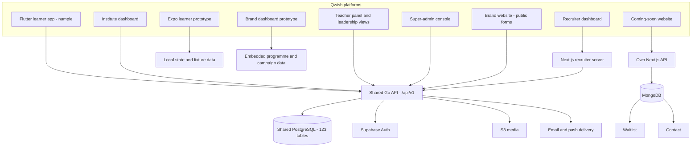

| Platform | Connected entities / integration |
| --- | --- |
| Flutter learner app (`numpie`) | Users, institute enrollment and classes, quizzes, assignments, attempts, profiles, rewards, learner insights, notices, activities, and notifications via the Go API. Parent relationships are a backend capability; no separate parent-dashboard project is present. |
| Institute dashboard | Institutions, joining and invites, users and classes, departments and staff roles, academic years and curricula, assessment approvals, learning support, portfolio reviews, notices, reports and analytics. |
| Teacher panel | Assigned classes and learners, reusable assessments and favorites, curriculum mapping, assignments, response evidence, misconceptions and support, topic requests, forms/polls, notices and preferences. Leadership access is granted by staff-role assignments. |
| Super-admin | Admin accounts, institutions, users, platform settings, quiz moderation, brands/sponsorships, content delivery, surveys, reports, audit and point-economy configuration. |
| Recruiter dashboard | Recruiter organisations and memberships, hiring roles, candidate states and audit; opt-in user/profile data through a Next.js server and the Go API. |
| Brand website | Public contact submissions and institution-application requests to the Go API. An application is onboarding workflow/input, not an extra table asserted by this map. |
| Coming-soon website | Own Next.js API and MongoDB Waitlist/Contact models. No checked-in FK or synchronization bridge to PostgreSQL. |
| Expo web/mobile prototype | Current shell uses fixtures/local state. A service module contains optional live profile/insight reads with mock fallbacks; this is not a complete shared-backend learner workflow. |
| Brand dashboard prototype | Embedded programme/campaign data. Persisted brands and sponsorships are managed by the backend/admin surfaces; no implemented brand-dashboard API integration was found. |
| HR LeetCode monitor extension | Review material only in this workspace; no implemented extension entities or runtime integration established. |

## Core business relationships

This is a semantic overview: some nodes combine tables and intermediary join tables are collapsed. Detailed diagrams below use exact SQL foreign keys.

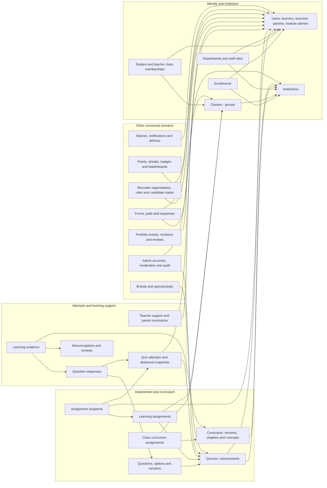

## Reading the detailed diagrams

- Solid arrows point from the **referencing table to the referenced table**. Labels name the foreign-key column(s). They do not assert one-to-one cardinality or user access permissions.
- Composite foreign keys remain one labeled edge, preserving institution scope.
- Each table has one primary domain. Domain diagrams also show referenced tables from other domains, with dashed outlines.
- Tables without FK edges are still listed. JSON fields and polymorphic references are not automatically treated as SQL foreign keys.

## Important implementation distinctions

- Student, teacher, parent and institution-admin are roles on `users`, not separate person tables. Platform admin identities also have `admin_accounts`; do not assume every admin identity has an enforced FK to `users`.
- Students can have live enrollments in up to two institutes. For students, `users.institution_id` points to the active institute; `enrollments` captures memberships.
- Leadership is expressed by scoped `staff_role_assignments`. A teacher assigned HOD remains a teacher in `users.role`.
- `groups` means institution classes; `study_groups` is a distinct learner/social entity.
- A reusable quiz is distinct from a class learning assignment. Recipients connect assigned students to their attempts. Follow-up review fields live on `learning_assignments`, not a separate follow-up table.
- Published question versions and delivered attempt snapshots preserve historical scoring and concept/option context.
- `learning_evidence_misconceptions` supports multiple misconception tags per evidence row. The older nullable `learning_evidence.misconception_id` remains in the schema, so both edges appear.
- Forms and identified polls share `activities`; anonymous surveys are a separate model.
- Activity question definitions, response answers, options, snapshots and some audit/job metadata live in JSON fields, not separate tables.
- `admission_policies`, `admission_requests`, `admission_targets` `student_edit_requests`, `promotion_batches` and `promotion_batch_students` were dropped in migrations 084–086 and are excluded.
- Points `reference_id`, notification references, content target identifiers, audit targets and job payloads can connect entities in application code without enforced FK edges.
- Runtime tables and materialized/read-model tables are included; they are not additional frontend platforms.

## 1. Identity and preferences

7 primary tables; 8 outbound FK relationships.

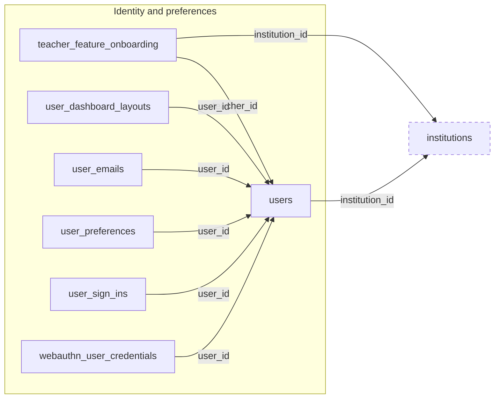

## 2. Institutions and memberships

13 primary tables; 33 outbound FK relationships.

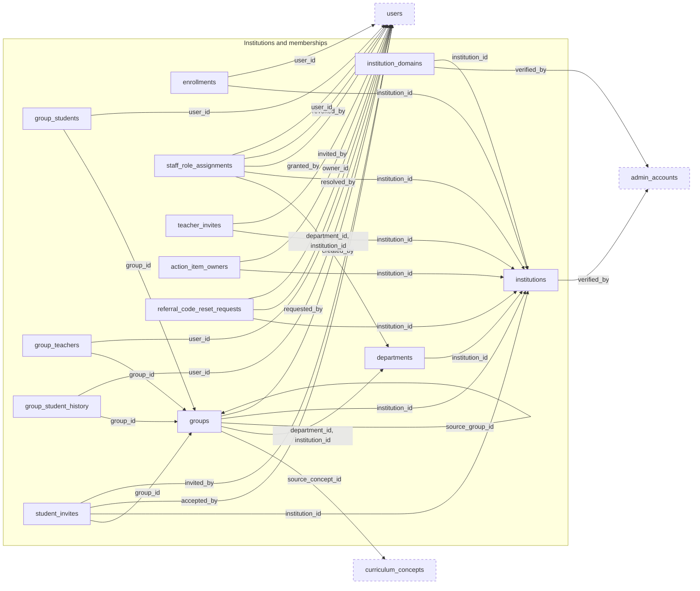

## 3. Curriculum

8 primary tables; 13 outbound FK relationships.

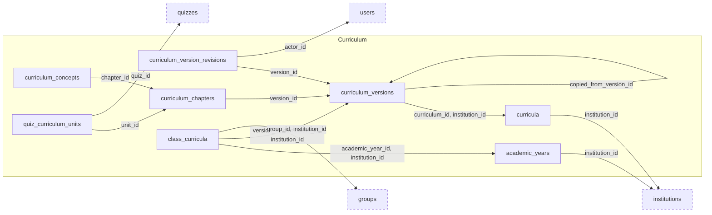

## 4. Assessments and attempts

16 primary tables; 32 outbound FK relationships.

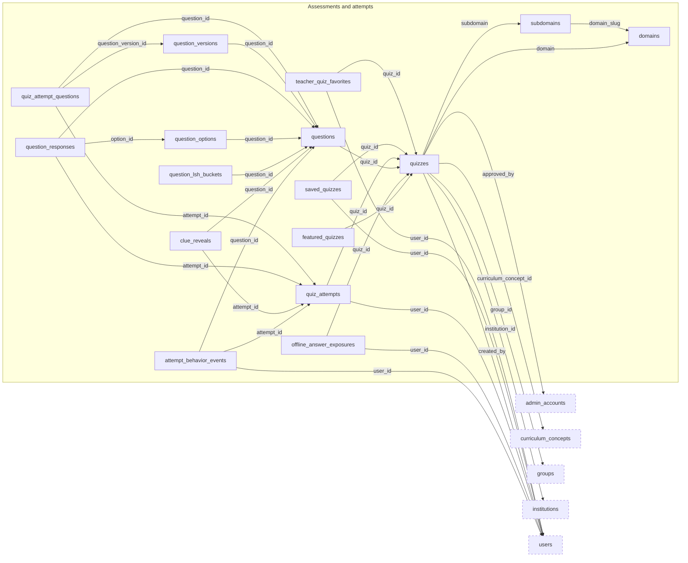

## 5. Assignments and learning evidence

12 primary tables; 46 outbound FK relationships.

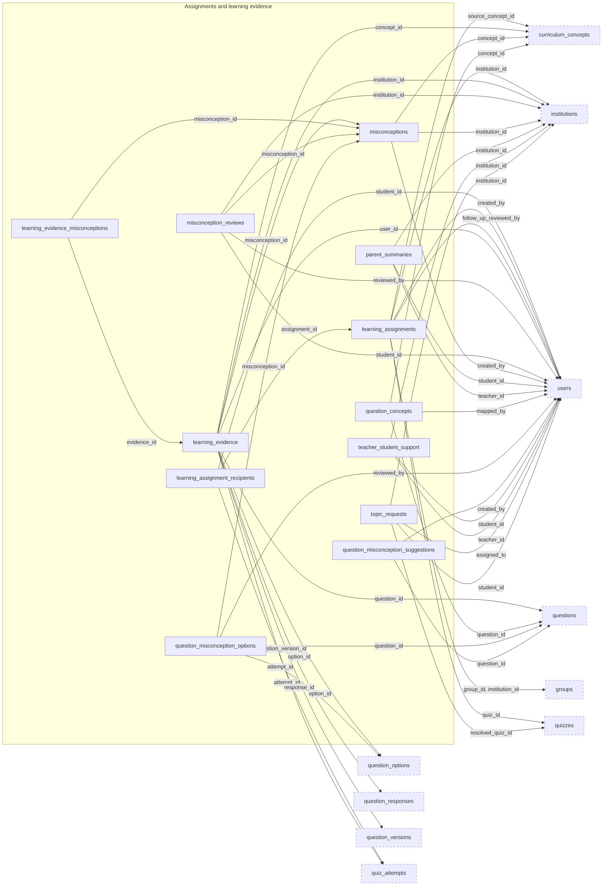

## 6. Portfolio and social

11 primary tables; 19 outbound FK relationships.

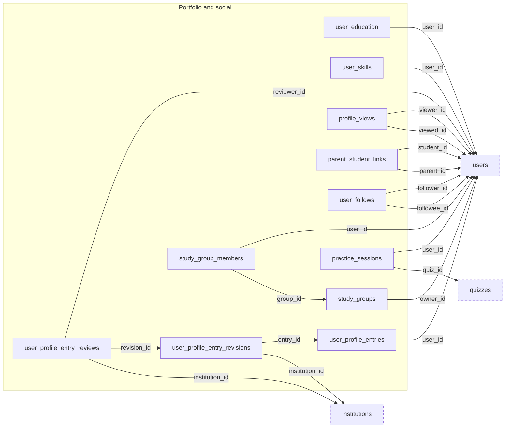

## 7. Recruitment

5 primary tables; 10 outbound FK relationships.

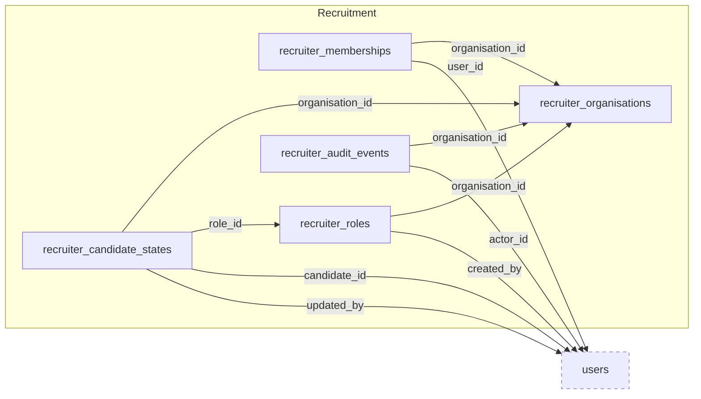

## 8. Rewards and rankings

8 primary tables; 9 outbound FK relationships.

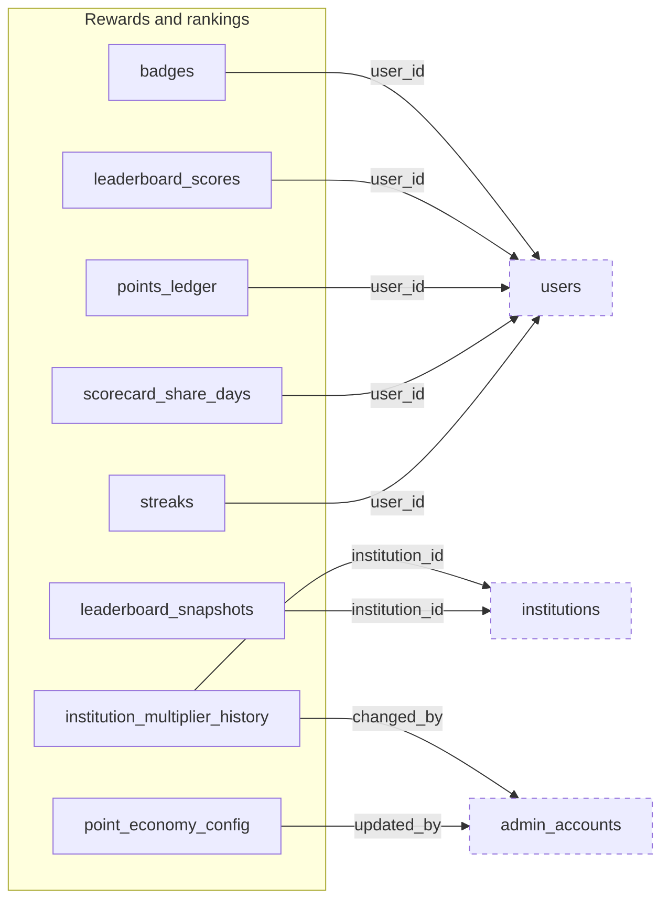

## 9. Forms and polls

6 primary tables; 12 outbound FK relationships.

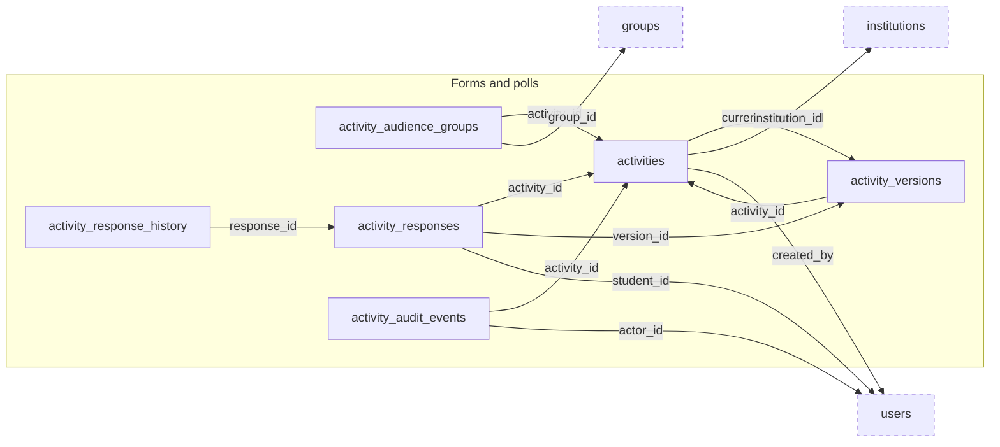

## 10. Communications and content

12 primary tables; 20 outbound FK relationships.

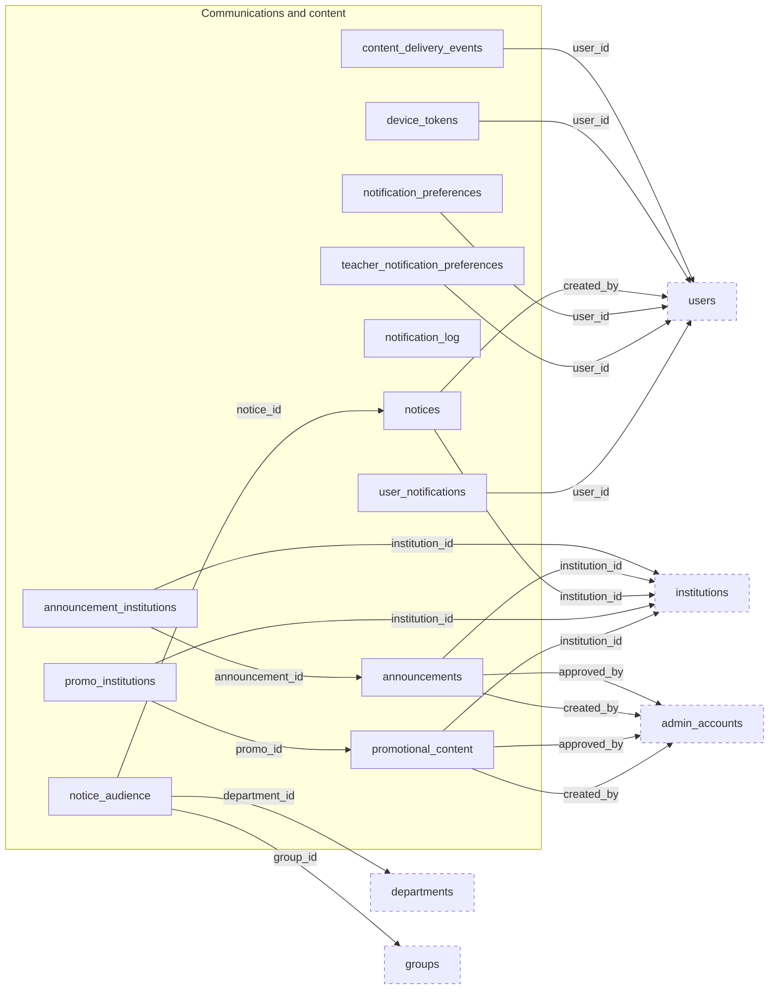

## 11. Brands and sponsorship

2 primary tables; 5 outbound FK relationships.

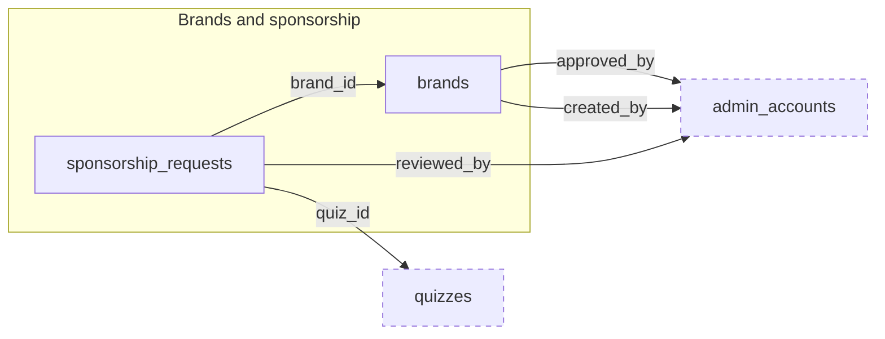

## 12. Administration and moderation

9 primary tables; 13 outbound FK relationships.

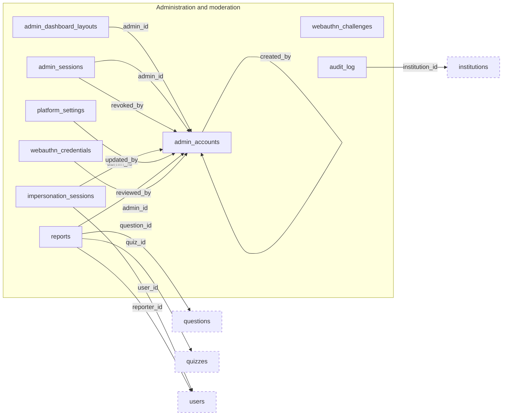

## 13. Public acquisition and anonymous research

6 primary tables; 8 outbound FK relationships.

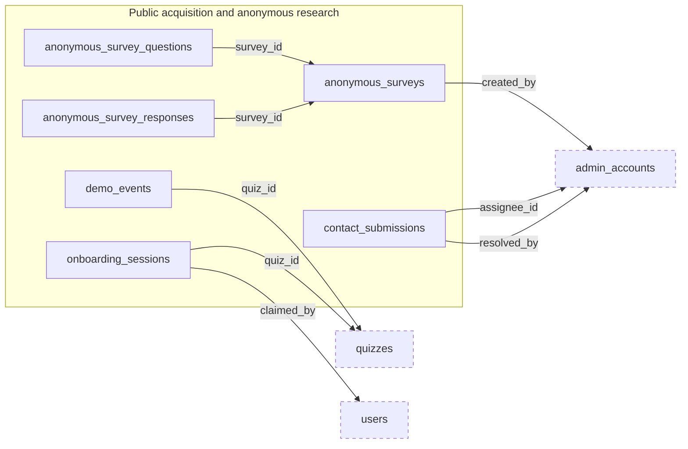

## 14. Analytics and runtime support

8 primary tables; 7 outbound FK relationships.

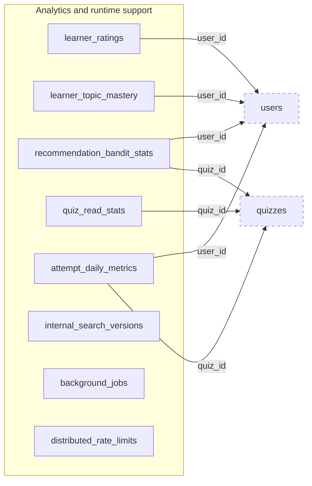

## Entity inventory and source migrations

| Domain | Entity | Defined in |
| --- | --- | --- |
| Identity and preferences | `users` | [001_initial.sql](../../migrations/001_initial.sql) |
| Identity and preferences | `user_emails` | [084_identity_and_joining.sql](../../migrations/084_identity_and_joining.sql) |
| Identity and preferences | `webauthn_user_credentials` | [025_user_passkeys.sql](../../migrations/025_user_passkeys.sql) |
| Identity and preferences | `user_sign_ins` | [078_institute_operations.sql](../../migrations/078_institute_operations.sql) |
| Identity and preferences | `user_preferences` | [080_teacher_panel_roadmap.sql](../../migrations/080_teacher_panel_roadmap.sql) |
| Identity and preferences | `user_dashboard_layouts` | [029_user_dashboard_layouts.sql](../../migrations/029_user_dashboard_layouts.sql) |
| Identity and preferences | `teacher_feature_onboarding` | [064_teacher_feature_onboarding.sql](../../migrations/064_teacher_feature_onboarding.sql) |
| Institutions and memberships | `institutions` | [001_initial.sql](../../migrations/001_initial.sql) |
| Institutions and memberships | `institution_domains` | [084_identity_and_joining.sql](../../migrations/084_identity_and_joining.sql) |
| Institutions and memberships | `enrollments` | [031_student_enrollment.sql](../../migrations/031_student_enrollment.sql) |
| Institutions and memberships | `groups` | [001_initial.sql](../../migrations/001_initial.sql) |
| Institutions and memberships | `group_students` | [001_initial.sql](../../migrations/001_initial.sql) |
| Institutions and memberships | `group_teachers` | [001_initial.sql](../../migrations/001_initial.sql) |
| Institutions and memberships | `group_student_history` | [086_classes_and_history.sql](../../migrations/086_classes_and_history.sql) |
| Institutions and memberships | `departments` | [083_leadership_roles.sql](../../migrations/083_leadership_roles.sql) |
| Institutions and memberships | `staff_role_assignments` | [083_leadership_roles.sql](../../migrations/083_leadership_roles.sql) |
| Institutions and memberships | `teacher_invites` | [009_teacher_invites_notification_log.sql](../../migrations/009_teacher_invites_notification_log.sql) |
| Institutions and memberships | `student_invites` | [084_identity_and_joining.sql](../../migrations/084_identity_and_joining.sql) |
| Institutions and memberships | `action_item_owners` | [078_institute_operations.sql](../../migrations/078_institute_operations.sql) |
| Institutions and memberships | `referral_code_reset_requests` | [036_referral_code_reset_requests.sql](../../migrations/036_referral_code_reset_requests.sql) |
| Curriculum | `academic_years` | [058_curriculum_foundation.sql](../../migrations/058_curriculum_foundation.sql) |
| Curriculum | `curricula` | [058_curriculum_foundation.sql](../../migrations/058_curriculum_foundation.sql) |
| Curriculum | `curriculum_versions` | [058_curriculum_foundation.sql](../../migrations/058_curriculum_foundation.sql) |
| Curriculum | `curriculum_version_revisions` | [077_curriculum_structure.sql](../../migrations/077_curriculum_structure.sql) |
| Curriculum | `curriculum_chapters` | [058_curriculum_foundation.sql](../../migrations/058_curriculum_foundation.sql) |
| Curriculum | `curriculum_concepts` | [058_curriculum_foundation.sql](../../migrations/058_curriculum_foundation.sql) |
| Curriculum | `class_curricula` | [058_curriculum_foundation.sql](../../migrations/058_curriculum_foundation.sql) |
| Curriculum | `quiz_curriculum_units` | [069_quiz_curriculum_units.sql](../../migrations/069_quiz_curriculum_units.sql) |
| Assessments and attempts | `quizzes` | [001_initial.sql](../../migrations/001_initial.sql) |
| Assessments and attempts | `questions` | [001_initial.sql](../../migrations/001_initial.sql) |
| Assessments and attempts | `question_options` | [059_learning_evidence_foundation.sql](../../migrations/059_learning_evidence_foundation.sql) |
| Assessments and attempts | `question_versions` | [059_learning_evidence_foundation.sql](../../migrations/059_learning_evidence_foundation.sql) |
| Assessments and attempts | `quiz_attempts` | [001_initial.sql](../../migrations/001_initial.sql) |
| Assessments and attempts | `quiz_attempt_questions` | [043_super_admin_quiz_delivery.sql](../../migrations/043_super_admin_quiz_delivery.sql) |
| Assessments and attempts | `question_responses` | [001_initial.sql](../../migrations/001_initial.sql) |
| Assessments and attempts | `attempt_behavior_events` | [044_attempt_behavior_events.sql](../../migrations/044_attempt_behavior_events.sql) |
| Assessments and attempts | `clue_reveals` | [026_attempt_anticheat.sql](../../migrations/026_attempt_anticheat.sql) |
| Assessments and attempts | `offline_answer_exposures` | [094_security_hardening.sql](../../migrations/094_security_hardening.sql) |
| Assessments and attempts | `saved_quizzes` | [001_initial.sql](../../migrations/001_initial.sql) |
| Assessments and attempts | `teacher_quiz_favorites` | [061_teacher_assessment_library.sql](../../migrations/061_teacher_assessment_library.sql) |
| Assessments and attempts | `featured_quizzes` | [046_featured_quizzes.sql](../../migrations/046_featured_quizzes.sql) |
| Assessments and attempts | `domains` | [020_quiz_domains.sql](../../migrations/020_quiz_domains.sql) |
| Assessments and attempts | `subdomains` | [020_quiz_domains.sql](../../migrations/020_quiz_domains.sql) |
| Assessments and attempts | `question_lsh_buckets` | [051_question_lsh.sql](../../migrations/051_question_lsh.sql) |
| Assignments and learning evidence | `learning_assignments` | [060_learning_assignments.sql](../../migrations/060_learning_assignments.sql) |
| Assignments and learning evidence | `learning_assignment_recipients` | [060_learning_assignments.sql](../../migrations/060_learning_assignments.sql) |
| Assignments and learning evidence | `question_concepts` | [059_learning_evidence_foundation.sql](../../migrations/059_learning_evidence_foundation.sql) |
| Assignments and learning evidence | `misconceptions` | [059_learning_evidence_foundation.sql](../../migrations/059_learning_evidence_foundation.sql) |
| Assignments and learning evidence | `question_misconception_options` | [059_learning_evidence_foundation.sql](../../migrations/059_learning_evidence_foundation.sql) |
| Assignments and learning evidence | `question_misconception_suggestions` | [080_teacher_panel_roadmap.sql](../../migrations/080_teacher_panel_roadmap.sql) |
| Assignments and learning evidence | `learning_evidence` | [059_learning_evidence_foundation.sql](../../migrations/059_learning_evidence_foundation.sql) |
| Assignments and learning evidence | `learning_evidence_misconceptions` | [075_misconception_evidence_integrity.sql](../../migrations/075_misconception_evidence_integrity.sql) |
| Assignments and learning evidence | `misconception_reviews` | [059_learning_evidence_foundation.sql](../../migrations/059_learning_evidence_foundation.sql) |
| Assignments and learning evidence | `teacher_student_support` | [065_teacher_student_support.sql](../../migrations/065_teacher_student_support.sql) |
| Assignments and learning evidence | `parent_summaries` | [080_teacher_panel_roadmap.sql](../../migrations/080_teacher_panel_roadmap.sql) |
| Assignments and learning evidence | `topic_requests` | [001_initial.sql](../../migrations/001_initial.sql) |
| Portfolio and social | `user_education` | [003_profile_features.sql](../../migrations/003_profile_features.sql) |
| Portfolio and social | `user_skills` | [003_profile_features.sql](../../migrations/003_profile_features.sql) |
| Portfolio and social | `user_profile_entries` | [031_student_enrollment.sql](../../migrations/031_student_enrollment.sql) |
| Portfolio and social | `user_profile_entry_revisions` | [081_student_portfolio.sql](../../migrations/081_student_portfolio.sql) |
| Portfolio and social | `user_profile_entry_reviews` | [081_student_portfolio.sql](../../migrations/081_student_portfolio.sql) |
| Portfolio and social | `profile_views` | [003_profile_features.sql](../../migrations/003_profile_features.sql) |
| Portfolio and social | `parent_student_links` | [001_initial.sql](../../migrations/001_initial.sql) |
| Portfolio and social | `user_follows` | [012_app_features.sql](../../migrations/012_app_features.sql) |
| Portfolio and social | `study_groups` | [012_app_features.sql](../../migrations/012_app_features.sql) |
| Portfolio and social | `study_group_members` | [012_app_features.sql](../../migrations/012_app_features.sql) |
| Portfolio and social | `practice_sessions` | [012_app_features.sql](../../migrations/012_app_features.sql) |
| Recruitment | `recruiter_organisations` | [047_recruiter_workspace.sql](../../migrations/047_recruiter_workspace.sql) |
| Recruitment | `recruiter_memberships` | [047_recruiter_workspace.sql](../../migrations/047_recruiter_workspace.sql) |
| Recruitment | `recruiter_roles` | [047_recruiter_workspace.sql](../../migrations/047_recruiter_workspace.sql) |
| Recruitment | `recruiter_candidate_states` | [047_recruiter_workspace.sql](../../migrations/047_recruiter_workspace.sql) |
| Recruitment | `recruiter_audit_events` | [047_recruiter_workspace.sql](../../migrations/047_recruiter_workspace.sql) |
| Rewards and rankings | `points_ledger` | [001_initial.sql](../../migrations/001_initial.sql) |
| Rewards and rankings | `streaks` | [001_initial.sql](../../migrations/001_initial.sql) |
| Rewards and rankings | `badges` | [001_initial.sql](../../migrations/001_initial.sql) |
| Rewards and rankings | `leaderboard_scores` | [052_incremental_leaderboard.sql](../../migrations/052_incremental_leaderboard.sql) |
| Rewards and rankings | `leaderboard_snapshots` | [001_initial.sql](../../migrations/001_initial.sql) |
| Rewards and rankings | `scorecard_share_days` | [056_achievements.sql](../../migrations/056_achievements.sql) |
| Rewards and rankings | `point_economy_config` | [001_initial.sql](../../migrations/001_initial.sql) |
| Rewards and rankings | `institution_multiplier_history` | [071_admin_console.sql](../../migrations/071_admin_console.sql) |
| Forms and polls | `activities` | [082_activities.sql](../../migrations/082_activities.sql) |
| Forms and polls | `activity_audience_groups` | [082_activities.sql](../../migrations/082_activities.sql) |
| Forms and polls | `activity_versions` | [082_activities.sql](../../migrations/082_activities.sql) |
| Forms and polls | `activity_responses` | [082_activities.sql](../../migrations/082_activities.sql) |
| Forms and polls | `activity_response_history` | [082_activities.sql](../../migrations/082_activities.sql) |
| Forms and polls | `activity_audit_events` | [082_activities.sql](../../migrations/082_activities.sql) |
| Communications and content | `notices` | [087_notices_and_remedial.sql](../../migrations/087_notices_and_remedial.sql) |
| Communications and content | `notice_audience` | [087_notices_and_remedial.sql](../../migrations/087_notices_and_remedial.sql) |
| Communications and content | `user_notifications` | [010_user_notifications.sql](../../migrations/010_user_notifications.sql) |
| Communications and content | `notification_preferences` | [012_app_features.sql](../../migrations/012_app_features.sql) |
| Communications and content | `teacher_notification_preferences` | [080_teacher_panel_roadmap.sql](../../migrations/080_teacher_panel_roadmap.sql) |
| Communications and content | `notification_log` | [009_teacher_invites_notification_log.sql](../../migrations/009_teacher_invites_notification_log.sql) |
| Communications and content | `device_tokens` | [011_device_tokens.sql](../../migrations/011_device_tokens.sql) |
| Communications and content | `announcements` | [001_initial.sql](../../migrations/001_initial.sql) |
| Communications and content | `announcement_institutions` | [055_content_targeting.sql](../../migrations/055_content_targeting.sql) |
| Communications and content | `promotional_content` | [001_initial.sql](../../migrations/001_initial.sql) |
| Communications and content | `promo_institutions` | [055_content_targeting.sql](../../migrations/055_content_targeting.sql) |
| Communications and content | `content_delivery_events` | [054_content_delivery_events.sql](../../migrations/054_content_delivery_events.sql) |
| Brands and sponsorship | `brands` | [006_brands_promos.sql](../../migrations/006_brands_promos.sql) |
| Brands and sponsorship | `sponsorship_requests` | [006_brands_promos.sql](../../migrations/006_brands_promos.sql) |
| Administration and moderation | `admin_accounts` | [001_initial.sql](../../migrations/001_initial.sql) |
| Administration and moderation | `admin_sessions` | [071_admin_console.sql](../../migrations/071_admin_console.sql) |
| Administration and moderation | `webauthn_credentials` | [017_webauthn_passkeys.sql](../../migrations/017_webauthn_passkeys.sql) |
| Administration and moderation | `webauthn_challenges` | [017_webauthn_passkeys.sql](../../migrations/017_webauthn_passkeys.sql) |
| Administration and moderation | `admin_dashboard_layouts` | [028_admin_dashboard_layouts.sql](../../migrations/028_admin_dashboard_layouts.sql) |
| Administration and moderation | `impersonation_sessions` | [001_initial.sql](../../migrations/001_initial.sql) |
| Administration and moderation | `audit_log` | [001_initial.sql](../../migrations/001_initial.sql) |
| Administration and moderation | `reports` | [001_initial.sql](../../migrations/001_initial.sql) |
| Administration and moderation | `platform_settings` | [071_admin_console.sql](../../migrations/071_admin_console.sql) |
| Public acquisition and anonymous research | `contact_submissions` | [008_contact_submissions.sql](../../migrations/008_contact_submissions.sql) |
| Public acquisition and anonymous research | `anonymous_surveys` | [053_anonymous_surveys.sql](../../migrations/053_anonymous_surveys.sql) |
| Public acquisition and anonymous research | `anonymous_survey_questions` | [053_anonymous_surveys.sql](../../migrations/053_anonymous_surveys.sql) |
| Public acquisition and anonymous research | `anonymous_survey_responses` | [053_anonymous_surveys.sql](../../migrations/053_anonymous_surveys.sql) |
| Public acquisition and anonymous research | `onboarding_sessions` | [041_onboarding_calibration.sql](../../migrations/041_onboarding_calibration.sql) |
| Public acquisition and anonymous research | `demo_events` | [023_demo_quiz_authoring_events.sql](../../migrations/023_demo_quiz_authoring_events.sql) |
| Analytics and runtime support | `learner_ratings` | [072_learner_ratings.sql](../../migrations/072_learner_ratings.sql) |
| Analytics and runtime support | `learner_topic_mastery` | [050_adaptive_learning.sql](../../migrations/050_adaptive_learning.sql) |
| Analytics and runtime support | `recommendation_bandit_stats` | [050_adaptive_learning.sql](../../migrations/050_adaptive_learning.sql) |
| Analytics and runtime support | `quiz_read_stats` | [091_quiz_read_models.sql](../../migrations/091_quiz_read_models.sql) |
| Analytics and runtime support | `attempt_daily_metrics` | [093_daily_attempt_metrics.sql](../../migrations/093_daily_attempt_metrics.sql) |
| Analytics and runtime support | `internal_search_versions` | [048_student_search_bloom_version.sql](../../migrations/048_student_search_bloom_version.sql) |
| Analytics and runtime support | `background_jobs` | [090_backend_reliability.sql](../../migrations/090_backend_reliability.sql) |
| Analytics and runtime support | `distributed_rate_limits` | [090_backend_reliability.sql](../../migrations/090_backend_reliability.sql) |
| Coming-soon MongoDB | `Waitlist` | [Waitlist.ts](https://github.com/suyog417/qwish-coming-soon-web/blob/main/src/models/Waitlist.ts) |
| Coming-soon MongoDB | `Contact` | [Contact.ts](https://github.com/suyog417/qwish-coming-soon-web/blob/main/src/models/Contact.ts) |

## Sources

- [Workspace architecture](ARCHITECTURE.MD)
- [Backend migrations](../../migrations)
- [API composition and route registration](../../cmd/api/main.go)
- [Backend API documentation](../../API_DOC.md)
- [Expo prototype service](https://github.com/qwish/qwish-web-app/blob/main/src/services/api.ts)
- [Coming-soon models](https://github.com/suyog417/qwish-coming-soon-web/tree/main/src/models)
